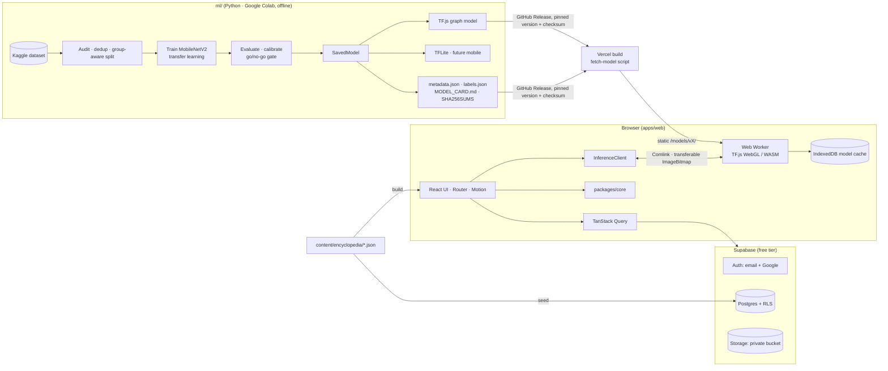

# RockID — Architecture

Status: **approved** (v1.0, 2026-10-31). Changes go through a short ADR in `docs/adr/`.

RockID lets users photograph or upload a rock or mineral, identifies it **in the browser**
(no server inference), explains it in a built-in encyclopedia, and lets signed-in users save
finds to a personal collection. Phase plan: [PHASES.md](PHASES.md).

---

## 1. Overview



Key decisions

- **On-device inference only.** Photos never leave the device unless a signed-in user saves a specimen.
- **Normalization lives inside the model** (`Rescaling(1/127.5, -1)` layer). Clients feed raw RGB
  uint8 at the input size. The only client-side steps (crop, bilinear resize, RGB order) are written
  in `metadata.json` and covered by a parity test, so web and mobile cannot drift apart.
- **Model files are static assets on Vercel** under versioned paths with `Cache-Control: immutable`,
  plus an IndexedDB copy. They never touch Supabase egress (5 GB/month on the free tier).
- **Encyclopedia content is JSON in the repo**: reviewed by PR, attribution next to each entry,
  shipped as static files (fast, works offline). The same JSON seeds a small `rock_classes` table
  so foreign keys stay valid.

## 2. Monorepo

```
rockid/
├─ apps/web/                 React + TS + Vite SPA (Phase 4)
│  ├─ public/models/         gitignored; filled by scripts/fetch-model.ts
│  ├─ src/app/               router, providers, layouts, error boundaries
│  ├─ src/features/          identify (incl. inference/ worker), collection, history, encyclopedia, auth
│  ├─ src/components/ui/     design-system primitives
│  └─ e2e/                   Playwright specs + fixture images
├─ packages/types/           generated DB types + domain types + ModelMetadata (no runtime code)
├─ packages/core/            business logic + utils, no DOM/React
├─ content/encyclopedia/     one JSON per class + image manifest with licenses
├─ ml/                       Python, NOT a pnpm workspace
│  ├─ rockid_ml/             reusable pipeline code (audit, dedup, split, train, export)
│  ├─ notebooks/             Colab drivers that call rockid_ml
│  ├─ splits/                committed split manifests
│  ├─ reports/               audit + evaluation reports
│  └─ tests/                 pytest
├─ supabase/                 migrations, seed.sql, pgTAP tests
└─ docs/
```

**Why `packages/core` instead of `utils` + `business-logic`:** at MVP size `utils` would hold a
handful of functions, and nothing needs one package without the other. Two packages would mean two
build configs and a fuzzy boundary. Split later if mobile reveals a real seam. Shared ESLint and TS
config stay as root files for the same reason.

`packages/core` contains: top-k and uncertainty decisions, label mapping, Zod schemas (forms,
model metadata, env), repository functions that take a `SupabaseClient` (reusable on mobile),
formatting helpers and quota rules.

## 3. ML pipeline

Runs on **Google Colab** (free T4 GPU). Colab sessions disconnect, so every notebook writes its
caches and outputs to Google Drive (`MyDrive/RockID/`) and can resume.

### 3.1 Audit (Phase 1)
| Check | Method |
|---|---|
| Class counts / imbalance | Counts per class, max/min ratio, flag classes under 150 clean images |
| Exact duplicates | SHA-256 of decoded pixels |
| Near-duplicates | pHash (Hamming ≤ 6) and MobileNetV2 embedding cosine ≥ 0.95, joined with union-find |
| Cross-class duplicates | Clusters with more than one label → label noise, excluded until reviewed |
| Quality | Decode errors, resolution, Laplacian blur score, contact sheets for watermark/diagram review |
| Background bias | Plain-background heuristic (border uniformity) per class + manual check of contact sheets |
| License | Kaggle metadata recorded. Web-scraped images are used for **training only**, never redistributed |
| Field set | Separate real-world photos (`MyDrive/RockID/field_test/<class>/`), deduplicated against the dataset |

### 3.2 Splits
70/15/15, stratified by class and **grouped by duplicate cluster** (scikit-learn
`StratifiedGroupKFold`), fixed seed. Exact duplicates keep one copy. Manifest committed to `ml/splits/`.

### 3.3 Training (Phase 2)
MobileNetV2 (α 1.0, 224 px, ImageNet). Head: Rescaling → GAP → Dropout 0.3 → Dense softmax.
Stage 1 frozen backbone (Adam 1e-3); stage 2 unfreeze the top ~30 % (BatchNorm frozen, lr 1e-5),
early stopping. Class weights, label smoothing 0.1, mild augmentation (hue kept mild: color is
diagnostic). Optional comparison: MobileNetV3-Large, EfficientNet-Lite0. Temperature scaling and
uncertain thresholds fitted on validation only. Before training, a **smoke test exports an untrained
model to TF.js** so the TensorFlow/Keras/converter versions are pinned first.

### 3.4 Gate (go/no-go before web inference)
1. Test top-1 ≥ 75 % and top-3 ≥ 90 %
2. Field-set top-3 ≥ 70 %
3. No class recall < 50 % (merge or drop instead)
4. Exported TF.js top-1 within 1 point of the SavedModel
5. Web model ≤ 5 MB

Thresholds are re-checked once the audit fixes the class count.

### 3.5 Export and versioning (Phase 3)
One SavedModel → TF.js (uint8 weight quantization, ≈3.5–4 MB; fp16 MobileNetV2 is ≈7 MB and misses
the budget; fallback α 0.75 or MobileNetV3) and TFLite (fp16 + int8). Release bundle: `model.json`
+ shards, `model.tflite`, `metadata.json` (input size, dtype, color order, resize method,
`normalization: in-graph`, ordered label slugs, temperature, thresholds, metrics), `labels.json`,
`MODEL_CARD.md`, `SHA256SUMS`. Version `rockid-<arch>-vMAJOR.MINOR.PATCH`; a label change is MAJOR.
Published as a GitHub Release and fetched at build time with checksum verification.

## 4. Database and RLS (Phase 5)

```sql
rock_classes(slug text PK, name text, kind text check (kind in ('rock','mineral')), content_version text, created_at)
model_versions(id text PK, arch text, labels text[] not null, input_size int, metrics jsonb, thresholds jsonb, is_active bool, released_at)
profiles(id uuid PK → auth.users on delete cascade, display_name text, created_at, updated_at)
identifications(id uuid PK, user_id uuid not null default auth.uid() → auth.users cascade,
  model_version text → model_versions, predictions jsonb not null, top1_slug text → rock_classes,
  top1_confidence real, is_uncertain bool, inference_ms int, backend text, created_at)
  index (user_id, created_at desc)
specimens(id uuid PK, user_id uuid not null default auth.uid() → auth.users cascade,
  identification_id uuid null → identifications on delete set null, class_slug text null → rock_classes,
  title text, notes text check (length(notes) <= 5000), found_on date, lat numeric(8,5), lng numeric(8,5),
  location_label text, photo_path text, thumb_path text, created_at, updated_at)
  index (user_id, created_at desc), index (user_id, class_slug)
```

- RLS on every table. `profiles`: select/update own. `identifications`: select/insert/delete own
  (append-only). `specimens`: full CRUD own, `USING` and `WITH CHECK` on `user_id = (select auth.uid())`.
  `rock_classes`, `model_versions`: public select, no client writes.
- Quota trigger: 200 specimens per user (keeps us inside the 1 GB free storage).
- Storage bucket `specimen-photos`, private, path `{user_id}/{specimen_id}/{full|thumb}.webp`,
  2 MB limit, MIME allowlist webp/jpeg. Client compresses (1600 px WebP q≈0.8 + 400 px thumbnail);
  re-encoding through canvas strips EXIF incl. GPS. Signed URLs for display. Deleting a specimen
  deletes its objects; a weekly job removes orphans; account deletion cascades.
- Types generated with `supabase gen types` into `packages/types`; CI fails on drift.
- pgTAP tests prove cross-user access is denied on every table and the bucket.

## 5. Frontend (Phases 4, 6–8)

Routes — public: `/`, `/identify`, `/encyclopedia`, `/encyclopedia/:slug`, `/about`, `/privacy`,
`/auth/sign-in`, `/auth/callback`, `*`. Signed in: `/collection`, `/collection/new?from=…`,
`/collection/:id`, `/collection/:id/edit`, `/history`, `/account`.

- Server state: TanStack Query with repositories from `core`. Auth: `AuthProvider` context.
  Identify flow: typed `useReducer` state machine. Forms: React Hook Form + Zod.
- Tailwind v4 (Vite plugin), Motion via `LazyMotion`, `<MotionConfig reducedMotion="user">`,
  only transform and opacity animated.
- Inference: prefetch the model when `/identify` opens or a file is picked → capture via
  `<input type="file" accept="image/*" capture="environment">` → `createImageBitmap` (EXIF
  orientation) → crop → transfer to the worker. Worker: WebGL on OffscreenCanvas → WASM SIMD →
  main-thread fallback; model from IndexedDB or network; warm-up after load. TF.js is imported only
  in the worker. `core` turns probabilities into top-3 + uncertain (top-1 < τ or margin < m).
  Results always show the disclaimer and a safety note.
- Accessibility: landmarks, visible focus, keyboard-operable cropper, confidence as text, axe in CI.

## 6. Testing and deployment
Vitest (`core`, reducers, components), pgTAP (RLS), Playwright against local Supabase (guest
identify, auth, collection CRUD, axe, model parity), pytest in `ml/` (split leakage, metadata,
export parity). GitHub Actions on every PR; Lighthouse CI on the Vercel preview; migrations pushed
from `main` behind manual approval. Only the Supabase URL and anon key reach the client.

## 7. Risks
See the risk table in the approved plan; top three: studio-photo bias, classes that are visually
inseparable, and out-of-distribution inputs getting confident labels. Mitigations: field test set in
the gate, top-3 + uncertain UI, class merges, calibration.

## 8. Notes on workspace instructions
The parent `CLAUDE.md` describes a single-file Tailwind-CDN site with `serve.mjs`/`screenshot.mjs`.
This project uses the approved Vite stack instead, with Playwright for screenshots. Its design
guardrails still apply to UI work.
