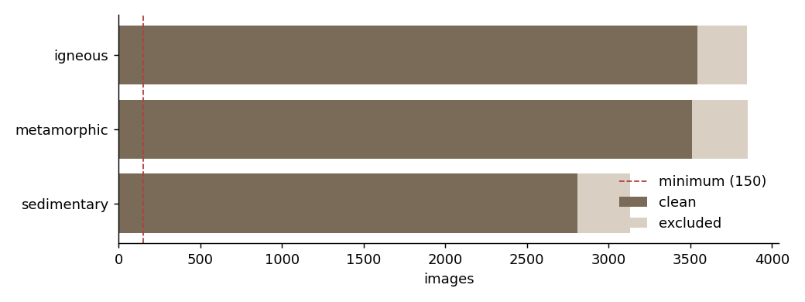
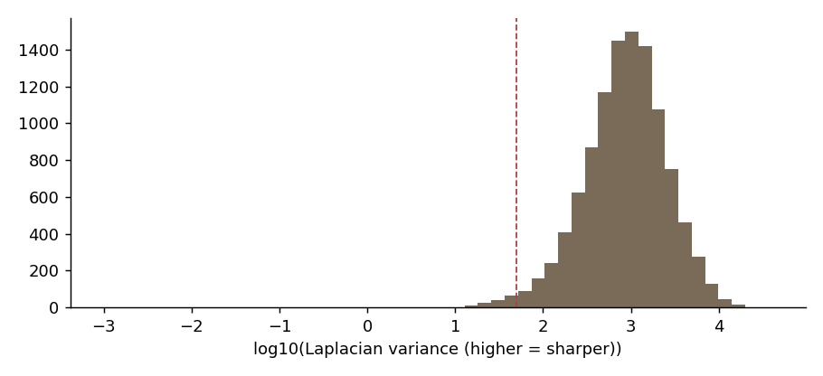
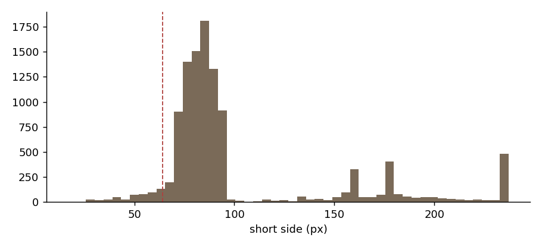
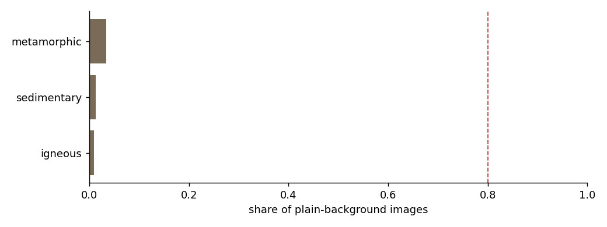

# RockID dataset audit

Generated 2026-10-31 21:19 UTC · dataset `kutlayusta/type-of-rocks-and-minerals-dataset`

## Summary

- **Images found:** 10,830
- **Classes:** 3 (from 3 folder names) → 3 kept
- **Decode errors:** 0
- **Clean images:** 9,862 (91%)
- **Excluded:** {'too_small': 474, 'cross_class_duplicate': 461, 'exact_duplicate': 33}
- **Classes below minimum:** none
- **Splits:** {'train': 6919, 'val': 1480, 'test': 1463}
- **Leakage check:** passed (no duplicate cluster spans two splits)
- **Field set:** missing

## License

- Kaggle license field: **not stated**

Images in this dataset appear to be collected from the web, so the dataset license may not cover the copyright of each image. RockID uses them **for training and evaluation only**. They are never redistributed, shown in the app, or used as encyclopedia images. Encyclopedia images come from Wikimedia Commons with per-image licenses (Phase 8).

## Label source

Labels come from each image's parent folder name, slugified. Pre-made split folders (train/test/valid) are ignored, because we re-split.

## Classes



| class | raw_names | total | clean | train | val | test | exact_duplicate | cross_class_duplicate | decode_error | too_small | plain_bg_share | blurry_share | probe_recall | nearest_class | nearest_sim | status |
|---|---|---|---|---|---|---|---|---|---|---|---|---|---|---|---|---|
| igneous | igneous | 3848 | 3543 | 2489 | 528 | 526 | 4 | 138 | 0 | 163 | 0.01 | 0.00 | 0.57 | metamorphic | 0.99 | ok |
| metamorphic | metamorphic | 3851 | 3509 | 2463 | 534 | 512 | 7 | 188 | 0 | 147 | 0.03 | 0.03 | 0.58 | igneous | 0.99 | ok |
| sedimentary | sedimentary | 3131 | 2810 | 1967 | 418 | 425 | 22 | 135 | 0 | 164 | 0.01 | 0.02 | 0.58 | metamorphic | 0.98 | ok |

## Duplicates

- Exact-duplicate groups: 117
- Near-duplicate pairs (pHash): 1555
- Near-duplicate pairs (embedding): 508
- Clusters with more than one image: 1016
- Images in such clusters: 2310
- Largest cluster: 22

Near-duplicates are grouped into clusters; a cluster always lands in a single split. Exact copies keep one image.

## Quality





## Background bias



Share of images per class whose border is nearly one color (studio or plain-backdrop shots). This is a heuristic; the contact sheets show what it means in practice.

Background-only linear probe (center 70% hidden): top-1 **56.0%** vs chance 33.3%.

## Linear probe (frozen MobileNetV2 features, 5-fold group CV)

- top-1 **57.5%**, top-3 **nan%**, chance 33.3%, majority class 35.9%
- A rough floor for fine-tuning, not a forecast of the final score.

Most frequent confusions (share of the true class):

| true | pred | count | share_of_true |
|---|---|---|---|
| igneous | metamorphic | 781 | 0.22 |
| metamorphic | igneous | 772 | 0.22 |
| sedimentary | igneous | 596 | 0.21 |
| sedimentary | metamorphic | 593 | 0.21 |
| igneous | sedimentary | 741 | 0.21 |
| metamorphic | sedimentary | 708 | 0.20 |

## Field test set

No field set found. Add real-world photos to `MyDrive/RockID/field_test/<class>/` (10–20 per class) before Phase 2: the gate needs them.

## Recommendations

- 189 duplicate clusters carry more than one label (label noise). Review `review/cross_class.jpg`; they are excluded from the splits.
- Linear probe on frozen features: top-1 57.5%, top-3 nan% (chance 33.3%). This is a rough floor for fine-tuning, not a prediction of the final score.
- Background-only probe: top-1 56.0% with the specimen hidden. That is 94% of the full probe's gain over chance, so the risk that backgrounds act as a shortcut is HIGH. The field test set is what settles it.

## Review before approving the class list

Contact sheets are in `review/`. **Do not commit `review/`**: it contains dataset images.

- `review/classes/igneous.jpg`
- `review/classes/metamorphic.jpg`
- `review/classes/sedimentary.jpg`
- `review/clusters_largest.jpg`
- `review/cross_class.jpg`
- `review/threshold_edge_pairs.jpg`
- `review/blurriest.jpg`
- `review/background_most_vs_least_plain.jpg`

To merge or drop classes, set `class_merges` / `drop_classes` in the notebook config and re-run from the split step.

## Config

```json
{
  "kaggle_dataset": "kutlayusta/type-of-rocks-and-minerals-dataset",
  "seed": 42,
  "val_frac": 0.15,
  "test_frac": 0.15,
  "min_images_per_class": 150,
  "min_side": 64,
  "phash_max_dist": 6,
  "emb_min_sim": 0.95,
  "plain_tol": 24.0,
  "plain_frac_threshold": 0.85,
  "studio_class_warn": 0.8,
  "blur_low": 50.0,
  "exclude_cross_class": true,
  "class_merges": {},
  "drop_classes": [],
  "background_probe": true,
  "embed_size": 224
}
```
