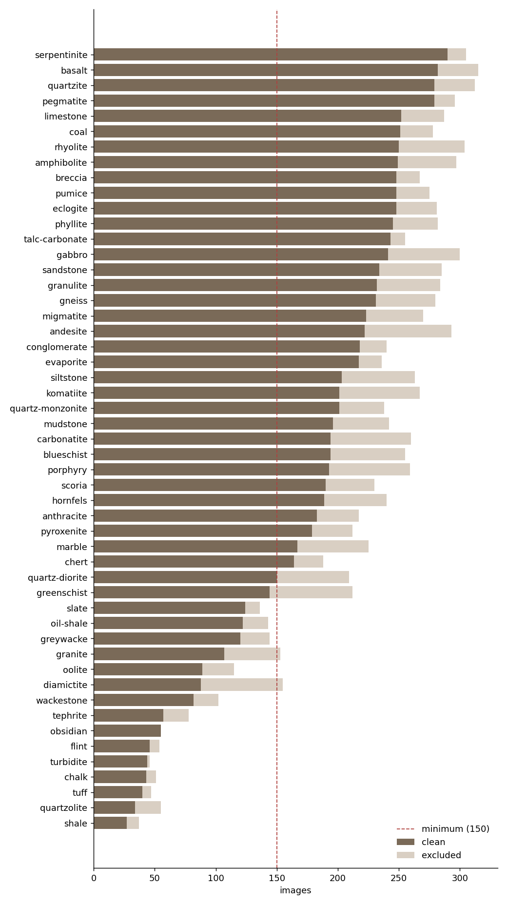
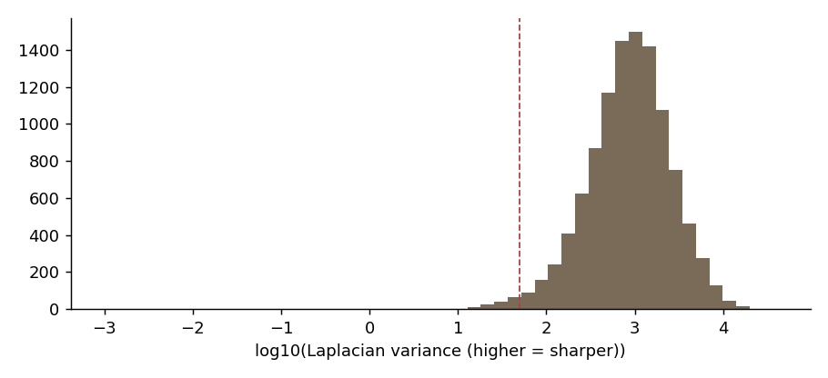
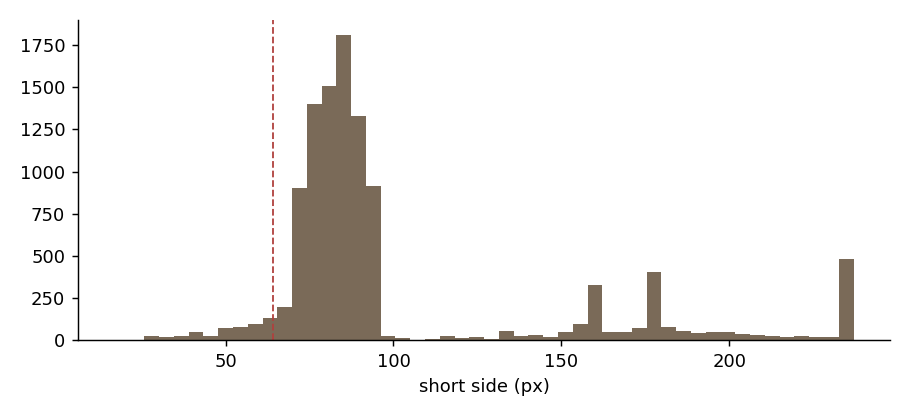
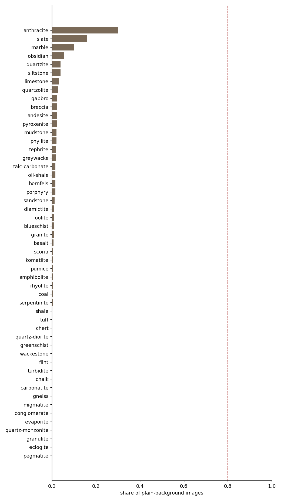

# RockID dataset audit

Generated 2026-11-01 09:39 UTC · dataset `kutlayusta/type-of-rocks-and-minerals-dataset`

## Summary

- **Images found:** 10,830
- **Classes:** 51 (from 51 raw names) → 51 kept
- **Decode errors:** 0
- **Clean images:** 9,008 (83%)
- **Excluded:** {'cross_class_duplicate': 1348, 'too_small': 474}
- **Classes below minimum:** greenschist, slate, oil-shale, greywacke, granite, oolite, diamictite, wackestone, tephrite, obsidian, flint, turbidite, chalk, tuff, quartzolite, shale
- **Splits:** {'train': 6303, 'test': 1354, 'val': 1351}
- **Leakage check:** passed (no duplicate cluster spans two splits)
- **Field set:** missing

## License

- Kaggle license field: **not stated**

Images in this dataset appear to be collected from the web, so the dataset license may not cover the copyright of each image. RockID uses them **for training and evaluation only**. They are never redistributed, shown in the app, or used as encyclopedia images. Encyclopedia images come from Wikimedia Commons with per-image licenses (Phase 8).

## Label source

Labels come from each file name (`100Andesite.png` → `andesite`). The parent folder is kept as the `family` column. Pre-made split folders (train/test/valid) are ignored, because we re-split.

## Classes



| class | family | raw_names | total | clean | train | val | test | exact_duplicate | cross_class_duplicate | decode_error | too_small | plain_bg_share | blurry_share | probe_recall | nearest_class | nearest_sim | status |
|---|---|---|---|---|---|---|---|---|---|---|---|---|---|---|---|---|---|
| serpentinite | metamorphic | Serpentinite | 305 | 290 | 188 | 47 | 55 | 0 | 11 | 0 | 4 | 0.00 | 0.00 | 0.49 | greenschist | 0.97 | ok |
| basalt | igneous | Basalt | 315 | 282 | 195 | 38 | 49 | 0 | 25 | 0 | 8 | 0.01 | 0.00 | 0.46 | greywacke | 0.96 | ok |
| pegmatite | igneous | Pegmatite | 296 | 279 | 190 | 42 | 47 | 0 | 12 | 0 | 5 | 0.00 | 0.01 | 0.31 | carbonatite | 0.98 | ok |
| quartzite | metamorphic | Quartzite | 312 | 279 | 189 | 38 | 52 | 0 | 32 | 0 | 1 | 0.04 | 0.06 | 0.37 | marble | 0.97 | ok |
| limestone | igneous, sedimentary | Limestone | 287 | 252 | 188 | 37 | 27 | 0 | 28 | 0 | 7 | 0.03 | 0.02 | 0.31 | siltstone | 0.97 | ok |
| coal | sedimentary | Coal | 278 | 251 | 173 | 43 | 35 | 0 | 24 | 0 | 3 | 0.00 | 0.00 | 0.65 | oil-shale | 0.96 | ok |
| rhyolite | igneous | Rhyolite | 304 | 250 | 176 | 36 | 38 | 0 | 49 | 0 | 5 | 0.00 | 0.00 | 0.16 | porphyry | 0.98 | ok |
| amphibolite | metamorphic | Amphibolite | 297 | 249 | 170 | 29 | 50 | 0 | 36 | 0 | 12 | 0.00 | 0.00 | 0.18 | pyroxenite | 0.99 | ok |
| breccia | sedimentary | Breccia | 267 | 248 | 164 | 42 | 42 | 0 | 12 | 0 | 7 | 0.02 | 0.06 | 0.49 | marble | 0.96 | ok |
| pumice | igneous | Pumice | 275 | 248 | 171 | 33 | 44 | 0 | 25 | 0 | 2 | 0.00 | 0.00 | 0.67 | oolite | 0.93 | ok |
| eclogite | metamorphic | Eclogite | 281 | 248 | 163 | 50 | 35 | 0 | 26 | 0 | 7 | 0.00 | 0.00 | 0.55 | granulite | 0.96 | ok |
| phyllite | metamorphic | Phyllite | 282 | 245 | 182 | 28 | 35 | 0 | 32 | 0 | 5 | 0.02 | 0.00 | 0.19 | greenschist | 0.98 | ok |
| talc-carbonate | metamorphic | Talc_carbonate | 255 | 243 | 171 | 44 | 28 | 0 | 11 | 0 | 1 | 0.02 | 0.05 | 0.54 | limestone | 0.96 | ok |
| gabbro | igneous | Gabbro | 300 | 241 | 175 | 36 | 30 | 0 | 53 | 0 | 6 | 0.02 | 0.00 | 0.32 | amphibolite | 0.98 | ok |
| sandstone | sedimentary | Sandstone | 285 | 234 | 159 | 38 | 37 | 0 | 42 | 0 | 9 | 0.01 | 0.01 | 0.59 | mudstone | 0.95 | ok |
| granulite | metamorphic | Granulite | 284 | 232 | 149 | 43 | 40 | 0 | 30 | 0 | 22 | 0.00 | 0.00 | 0.07 | quartz-monzonite | 0.99 | ok |
| gneiss | metamorphic | Gneiss | 280 | 231 | 166 | 35 | 30 | 0 | 49 | 0 | 0 | 0.00 | 0.00 | 0.24 | migmatite | 0.98 | ok |
| migmatite | metamorphic | Migmatite | 270 | 223 | 160 | 26 | 37 | 0 | 28 | 0 | 19 | 0.00 | 0.00 | 0.17 | gneiss | 0.98 | ok |
| andesite | igneous | Andesite | 293 | 222 | 157 | 32 | 33 | 0 | 66 | 0 | 5 | 0.02 | 0.00 | 0.20 | porphyry | 0.98 | ok |
| conglomerate | sedimentary | Conglomerate | 240 | 218 | 159 | 31 | 28 | 0 | 16 | 0 | 6 | 0.00 | 0.00 | 0.42 | rhyolite | 0.97 | ok |
| evaporite | sedimentary | Evaporite | 236 | 217 | 156 | 29 | 32 | 0 | 9 | 0 | 10 | 0.00 | 0.01 | 0.21 | chert | 0.98 | ok |
| siltstone | sedimentary | Siltstone | 263 | 203 | 145 | 25 | 33 | 0 | 39 | 0 | 21 | 0.04 | 0.02 | 0.08 | mudstone | 0.98 | ok |
| quartz-monzonite | igneous | Quartz_monzonite | 238 | 201 | 138 | 39 | 24 | 0 | 19 | 0 | 18 | 0.00 | 0.00 | 0.10 | granulite | 0.99 | ok |
| komatiite | igneous | Komatiite | 267 | 201 | 144 | 30 | 27 | 0 | 22 | 0 | 44 | 0.00 | 0.00 | 0.27 | greenschist | 0.99 | ok |
| mudstone | sedimentary | Mudstone | 242 | 196 | 147 | 23 | 26 | 0 | 39 | 0 | 7 | 0.02 | 0.02 | 0.11 | siltstone | 0.98 | ok |
| carbonatite | igneous | Carbonatite | 260 | 194 | 147 | 24 | 23 | 0 | 35 | 0 | 31 | 0.00 | 0.01 | 0.09 | quartz-monzonite | 0.98 | ok |
| blueschist | metamorphic | Blueschist | 255 | 194 | 136 | 36 | 22 | 0 | 36 | 0 | 25 | 0.01 | 0.00 | 0.18 | greenschist | 0.99 | ok |
| porphyry | igneous | Porphyry | 259 | 193 | 137 | 24 | 32 | 0 | 57 | 0 | 9 | 0.02 | 0.00 | 0.15 | granulite | 0.98 | ok |
| scoria | igneous | Scoria | 230 | 190 | 129 | 31 | 30 | 0 | 34 | 0 | 6 | 0.01 | 0.00 | 0.42 | quartz-monzonite | 0.96 | ok |
| hornfels | metamorphic | Hornfels | 240 | 189 | 139 | 26 | 24 | 0 | 31 | 0 | 20 | 0.02 | 0.01 | 0.16 | greenschist | 0.98 | ok |
| anthracite | metamorphic | Anthracite | 217 | 183 | 137 | 27 | 19 | 0 | 28 | 0 | 6 | 0.30 | 0.19 | 0.62 | gabbro | 0.92 | ok |
| pyroxenite | igneous | Pyroxenite | 212 | 179 | 119 | 27 | 33 | 0 | 27 | 0 | 6 | 0.02 | 0.01 | 0.10 | amphibolite | 0.99 | ok |
| marble | metamorphic | Marble | 225 | 167 | 122 | 23 | 22 | 0 | 57 | 0 | 1 | 0.10 | 0.08 | 0.41 | quartzite | 0.97 | ok |
| chert | sedimentary | Chert | 188 | 164 | 116 | 22 | 26 | 0 | 14 | 0 | 10 | 0.00 | 0.02 | 0.16 | evaporite | 0.98 | ok |
| quartz-diorite | igneous | Quartz_diorite | 209 | 150 | 102 | 29 | 19 | 0 | 57 | 0 | 2 | 0.00 | 0.00 | 0.39 | granulite | 0.95 | ok |
| greenschist | metamorphic | Greenschist | 212 | 144 | 111 | 19 | 14 | 0 | 46 | 0 | 22 | 0.00 | 0.01 | 0.06 | blueschist | 0.99 | below_min |
| slate | metamorphic | Slate | 136 | 124 | 84 | 19 | 21 | 0 | 10 | 0 | 2 | 0.16 | 0.06 | 0.44 | mudstone | 0.95 | below_min |
| oil-shale | sedimentary | Oil_shale | 143 | 122 | 83 | 20 | 19 | 0 | 18 | 0 | 3 | 0.02 | 0.01 | 0.25 | mudstone | 0.97 | below_min |
| greywacke | sedimentary | Greywacke | 144 | 120 | 72 | 25 | 23 | 0 | 12 | 0 | 12 | 0.02 | 0.01 | 0.10 | greenschist | 0.99 | below_min |
| granite | igneous | Granite | 153 | 107 | 76 | 15 | 16 | 0 | 46 | 0 | 0 | 0.01 | 0.00 | 0.40 | granulite | 0.97 | below_min |
| oolite | sedimentary | Oolite | 115 | 89 | 63 | 12 | 14 | 0 | 23 | 0 | 3 | 0.01 | 0.00 | 0.28 | andesite | 0.96 | below_min |
| diamictite | sedimentary | Diamictite | 155 | 88 | 59 | 13 | 16 | 0 | 6 | 0 | 61 | 0.01 | 0.01 | 0.32 | greenschist | 0.96 | below_min |
| wackestone | sedimentary | Wackestone | 102 | 82 | 61 | 10 | 11 | 0 | 15 | 0 | 5 | 0.00 | 0.01 | 0.35 | greywacke | 0.96 | below_min |
| tephrite | igneous | Tephrite | 78 | 57 | 40 | 11 | 6 | 0 | 6 | 0 | 15 | 0.02 | 0.00 | 0.18 | quartz-monzonite | 0.96 | below_min |
| obsidian | igneous | Obsidian | 55 | 55 | 39 | 8 | 8 | 0 | 0 | 0 | 0 | 0.05 | 0.00 | 0.78 | coal | 0.88 | below_min |
| flint | sedimentary | Flint | 54 | 46 | 32 | 7 | 7 | 0 | 8 | 0 | 0 | 0.00 | 0.00 | 0.43 | chert | 0.90 | below_min |
| turbidite | sedimentary | Turbidite | 46 | 44 | 28 | 7 | 9 | 0 | 2 | 0 | 0 | 0.00 | 0.00 | 0.39 | shale | 0.94 | below_min |
| chalk | sedimentary | Chalk | 51 | 43 | 28 | 8 | 7 | 0 | 8 | 0 | 0 | 0.00 | 0.00 | 0.33 | mudstone | 0.91 | below_min |
| tuff | igneous | Tuff | 47 | 40 | 28 | 6 | 6 | 0 | 6 | 0 | 1 | 0.00 | 0.00 | 0.30 | quartzolite | 0.93 | below_min |
| quartzolite | igneous | Quartzolite | 55 | 34 | 22 | 5 | 7 | 0 | 21 | 0 | 0 | 0.03 | 0.03 | 0.26 | tephrite | 0.94 | below_min |
| shale | sedimentary | Shale | 37 | 27 | 18 | 3 | 6 | 0 | 10 | 0 | 0 | 0.00 | 0.00 | 0.07 | turbidite | 0.94 | below_min |

## Duplicates

- Exact-duplicate groups: 117
- Near-duplicate pairs (pHash): 1555
- Near-duplicate pairs (embedding): 508
- Clusters with more than one image: 1016
- Images in such clusters: 2310
- Largest cluster: 22

Near-duplicates are grouped into clusters; a cluster always lands in a single split. Exact copies keep one image.

## Quality





## Background bias



Share of images per class whose border is nearly one color (studio or plain-backdrop shots). This is a heuristic; the contact sheets show what it means in practice.

Background-only linear probe (center 70% hidden): top-1 **26.0%** vs chance 2.0%.

## Linear probe (frozen MobileNetV2 features, 5-fold group CV)

- top-1 **31.5%**, top-3 **50.7%**, chance 2.0%, majority class 3.2%
- A rough floor for fine-tuning, not a forecast of the final score.

Most frequent confusions (share of the true class):

| true | pred | count | share_of_true |
|---|---|---|---|
| shale | slate | 8 | 0.30 |
| turbidite | shale | 6 | 0.14 |
| flint | chert | 6 | 0.13 |
| limestone | talc-carbonate | 32 | 0.13 |
| marble | quartzite | 21 | 0.13 |
| migmatite | gneiss | 28 | 0.13 |
| tuff | chalk | 5 | 0.12 |
| anthracite | coal | 22 | 0.12 |
| shale | turbidite | 3 | 0.11 |
| gneiss | migmatite | 25 | 0.11 |
| quartz-diorite | gabbro | 15 | 0.10 |
| coal | anthracite | 24 | 0.10 |
| quartzite | marble | 26 | 0.09 |
| chalk | limestone | 4 | 0.09 |
| chalk | talc-carbonate | 4 | 0.09 |

## Field test set

No field set found. Add real-world photos to `MyDrive/RockID/field_test/<class>/` (10–20 per class) before Phase 2: the gate needs them.

## Recommendations

- Imbalance ratio is 10.7x (largest/smallest class). Use class weights, and consider capping the largest classes.
- 572 duplicate clusters carry more than one label (label noise). Review `review/cross_class.jpg`; they are excluded from the splits.
- Linear probe on frozen features: top-1 31.5%, top-3 50.7% (chance 2.0%). This is a rough floor for fine-tuning, not a prediction of the final score.
- Background-only probe: top-1 26.0% with the specimen hidden. That is 81% of the full probe's gain over chance, so the risk that backgrounds act as a shortcut is HIGH. The field test set is what settles it.
- **serpentinite**: probe recall 49%: at risk of failing the 50% recall gate; most similar class is `greenschist` (similarity 0.97).
- **basalt**: probe recall 46%: at risk of failing the 50% recall gate; most similar class is `greywacke` (similarity 0.96).
- **pegmatite**: probe recall 31%: at risk of failing the 50% recall gate; most similar class is `carbonatite` (similarity 0.98).
- **quartzite**: probe recall 37%: at risk of failing the 50% recall gate; most similar class is `marble` (similarity 0.97); 10% duplicates removed.
- **limestone**: probe recall 31%: at risk of failing the 50% recall gate; most similar class is `siltstone` (similarity 0.97).
- **rhyolite**: probe recall 16%: at risk of failing the 50% recall gate; most similar class is `porphyry` (similarity 0.98); 16% duplicates removed.
- **amphibolite**: probe recall 18%: at risk of failing the 50% recall gate; most similar class is `pyroxenite` (similarity 0.99); 12% duplicates removed.
- **breccia**: probe recall 49%: at risk of failing the 50% recall gate; most similar class is `marble` (similarity 0.96).
- **phyllite**: probe recall 19%: at risk of failing the 50% recall gate; most similar class is `greenschist` (similarity 0.98); 11% duplicates removed.
- **gabbro**: probe recall 32%: at risk of failing the 50% recall gate; most similar class is `amphibolite` (similarity 0.98); 18% duplicates removed.
- **sandstone**: 15% duplicates removed.
- **granulite**: probe recall 7%: at risk of failing the 50% recall gate; most similar class is `quartz-monzonite` (similarity 0.99); 11% duplicates removed.
- **gneiss**: probe recall 24%: at risk of failing the 50% recall gate; most similar class is `migmatite` (similarity 0.98); 18% duplicates removed.
- **migmatite**: probe recall 17%: at risk of failing the 50% recall gate; most similar class is `gneiss` (similarity 0.98); 10% duplicates removed.
- **andesite**: probe recall 20%: at risk of failing the 50% recall gate; most similar class is `porphyry` (similarity 0.98); 23% duplicates removed.
- **conglomerate**: probe recall 42%: at risk of failing the 50% recall gate; most similar class is `rhyolite` (similarity 0.97).
- **evaporite**: probe recall 21%: at risk of failing the 50% recall gate; most similar class is `chert` (similarity 0.98).
- **siltstone**: probe recall 8%: at risk of failing the 50% recall gate; most similar class is `mudstone` (similarity 0.98); 15% duplicates removed.
- **quartz-monzonite**: probe recall 10%: at risk of failing the 50% recall gate; most similar class is `granulite` (similarity 0.99).
- **komatiite**: probe recall 27%: at risk of failing the 50% recall gate; most similar class is `greenschist` (similarity 0.99).
- **mudstone**: probe recall 11%: at risk of failing the 50% recall gate; most similar class is `siltstone` (similarity 0.98); 16% duplicates removed.
- **carbonatite**: probe recall 9%: at risk of failing the 50% recall gate; most similar class is `quartz-monzonite` (similarity 0.98); 13% duplicates removed.
- **blueschist**: probe recall 18%: at risk of failing the 50% recall gate; most similar class is `greenschist` (similarity 0.99); 14% duplicates removed.
- **porphyry**: probe recall 15%: at risk of failing the 50% recall gate; most similar class is `granulite` (similarity 0.98); 22% duplicates removed.
- **scoria**: probe recall 42%: at risk of failing the 50% recall gate; most similar class is `quartz-monzonite` (similarity 0.96); 15% duplicates removed.
- **hornfels**: probe recall 16%: at risk of failing the 50% recall gate; most similar class is `greenschist` (similarity 0.98); 13% duplicates removed.
- **anthracite**: 13% duplicates removed; only 19 test images: per-class metrics will be noisy.
- **pyroxenite**: probe recall 10%: at risk of failing the 50% recall gate; most similar class is `amphibolite` (similarity 0.99); 13% duplicates removed.
- **marble**: probe recall 41%: at risk of failing the 50% recall gate; most similar class is `quartzite` (similarity 0.97); 25% duplicates removed.
- **chert**: probe recall 16%: at risk of failing the 50% recall gate; most similar class is `evaporite` (similarity 0.98).
- **quartz-diorite**: probe recall 39%: at risk of failing the 50% recall gate; most similar class is `granulite` (similarity 0.95); 27% duplicates removed; only 19 test images: per-class metrics will be noisy.
- **greenschist**: only 144 clean images (minimum 150): add data, drop, or merge into `blueschist` (similarity 0.99); probe recall 6%: at risk of failing the 50% recall gate; most similar class is `blueschist` (similarity 0.99); 22% duplicates removed.
- **slate**: only 124 clean images (minimum 150): add data, drop, or merge into `mudstone` (similarity 0.95); probe recall 44%: at risk of failing the 50% recall gate; most similar class is `mudstone` (similarity 0.95).
- **oil-shale**: only 122 clean images (minimum 150): add data, drop, or merge into `mudstone` (similarity 0.97); probe recall 25%: at risk of failing the 50% recall gate; most similar class is `mudstone` (similarity 0.97); 13% duplicates removed.
- **greywacke**: only 120 clean images (minimum 150): add data, drop, or merge into `greenschist` (similarity 0.99); probe recall 10%: at risk of failing the 50% recall gate; most similar class is `greenschist` (similarity 0.99).
- **granite**: only 107 clean images (minimum 150): add data, drop, or merge into `granulite` (similarity 0.97); probe recall 40%: at risk of failing the 50% recall gate; most similar class is `granulite` (similarity 0.97); 30% duplicates removed.
- **oolite**: only 89 clean images (minimum 150): add data, drop, or merge into `andesite` (similarity 0.96); probe recall 28%: at risk of failing the 50% recall gate; most similar class is `andesite` (similarity 0.96); 20% duplicates removed.
- **diamictite**: only 88 clean images (minimum 150): add data, drop, or merge into `greenschist` (similarity 0.96); probe recall 32%: at risk of failing the 50% recall gate; most similar class is `greenschist` (similarity 0.96).
- **wackestone**: only 82 clean images (minimum 150): add data, drop, or merge into `greywacke` (similarity 0.96); probe recall 35%: at risk of failing the 50% recall gate; most similar class is `greywacke` (similarity 0.96); 15% duplicates removed.
- **tephrite**: only 57 clean images (minimum 150): add data, drop, or merge into `quartz-monzonite` (similarity 0.96); probe recall 18%: at risk of failing the 50% recall gate; most similar class is `quartz-monzonite` (similarity 0.96).
- **obsidian**: only 55 clean images (minimum 150): add data, drop, or merge into `coal` (similarity 0.88).
- **flint**: only 46 clean images (minimum 150): add data, drop, or merge into `chert` (similarity 0.90); probe recall 43%: at risk of failing the 50% recall gate; most similar class is `chert` (similarity 0.90); 15% duplicates removed.
- **turbidite**: only 44 clean images (minimum 150): add data, drop, or merge into `shale` (similarity 0.94); probe recall 39%: at risk of failing the 50% recall gate; most similar class is `shale` (similarity 0.94).
- **chalk**: only 43 clean images (minimum 150): add data, drop, or merge into `mudstone` (similarity 0.91); probe recall 33%: at risk of failing the 50% recall gate; most similar class is `mudstone` (similarity 0.91); 16% duplicates removed.
- **tuff**: only 40 clean images (minimum 150): add data, drop, or merge into `quartzolite` (similarity 0.93); probe recall 30%: at risk of failing the 50% recall gate; most similar class is `quartzolite` (similarity 0.93); 13% duplicates removed.
- **quartzolite**: only 34 clean images (minimum 150): add data, drop, or merge into `tephrite` (similarity 0.94); probe recall 26%: at risk of failing the 50% recall gate; most similar class is `tephrite` (similarity 0.94); 38% duplicates removed.
- **shale**: only 27 clean images (minimum 150): add data, drop, or merge into `turbidite` (similarity 0.94); probe recall 7%: at risk of failing the 50% recall gate; most similar class is `turbidite` (similarity 0.94); 27% duplicates removed.

## Review before approving the class list

Contact sheets are in `review/`. **Do not commit `review/`**: it contains dataset images.

- `review/classes/amphibolite.jpg`
- `review/classes/andesite.jpg`
- `review/classes/anthracite.jpg`
- `review/classes/basalt.jpg`
- `review/classes/blueschist.jpg`
- `review/classes/breccia.jpg`
- `review/classes/carbonatite.jpg`
- `review/classes/chalk.jpg`
- `review/classes/chert.jpg`
- `review/classes/coal.jpg`
- `review/classes/conglomerate.jpg`
- `review/classes/diamictite.jpg`
- `review/classes/eclogite.jpg`
- `review/classes/evaporite.jpg`
- `review/classes/flint.jpg`
- `review/classes/gabbro.jpg`
- `review/classes/gneiss.jpg`
- `review/classes/granite.jpg`
- `review/classes/granulite.jpg`
- `review/classes/greenschist.jpg`
- `review/classes/greywacke.jpg`
- `review/classes/hornfels.jpg`
- `review/classes/komatiite.jpg`
- `review/classes/limestone.jpg`
- `review/classes/marble.jpg`
- `review/classes/migmatite.jpg`
- `review/classes/mudstone.jpg`
- `review/classes/obsidian.jpg`
- `review/classes/oil-shale.jpg`
- `review/classes/oolite.jpg`
- `review/classes/pegmatite.jpg`
- `review/classes/phyllite.jpg`
- `review/classes/porphyry.jpg`
- `review/classes/pumice.jpg`
- `review/classes/pyroxenite.jpg`
- `review/classes/quartz-diorite.jpg`
- `review/classes/quartz-monzonite.jpg`
- `review/classes/quartzite.jpg`
- `review/classes/quartzolite.jpg`
- `review/classes/rhyolite.jpg`
- `review/classes/sandstone.jpg`
- `review/classes/scoria.jpg`
- `review/classes/serpentinite.jpg`
- `review/classes/shale.jpg`
- `review/classes/siltstone.jpg`
- `review/classes/slate.jpg`
- `review/classes/talc-carbonate.jpg`
- `review/classes/tephrite.jpg`
- `review/classes/tuff.jpg`
- `review/classes/turbidite.jpg`
- `review/classes/wackestone.jpg`
- `review/clusters_largest.jpg`
- `review/cross_class.jpg`
- `review/threshold_edge_pairs.jpg`
- `review/blurriest.jpg`
- `review/background_most_vs_least_plain.jpg`

To merge or drop classes, set `class_merges` / `drop_classes` in the notebook config and re-run from the split step.

## Config

```json
{
  "kaggle_dataset": "kutlayusta/type-of-rocks-and-minerals-dataset",
  "seed": 42,
  "label_from": "filename",
  "val_frac": 0.15,
  "test_frac": 0.15,
  "min_images_per_class": 150,
  "min_side": 64,
  "phash_max_dist": 6,
  "emb_min_sim": 0.95,
  "plain_tol": 24.0,
  "plain_frac_threshold": 0.85,
  "studio_class_warn": 0.8,
  "blur_low": 50.0,
  "exclude_cross_class": true,
  "class_merges": {},
  "drop_classes": [],
  "background_probe": true,
  "embed_size": 224
}
```
