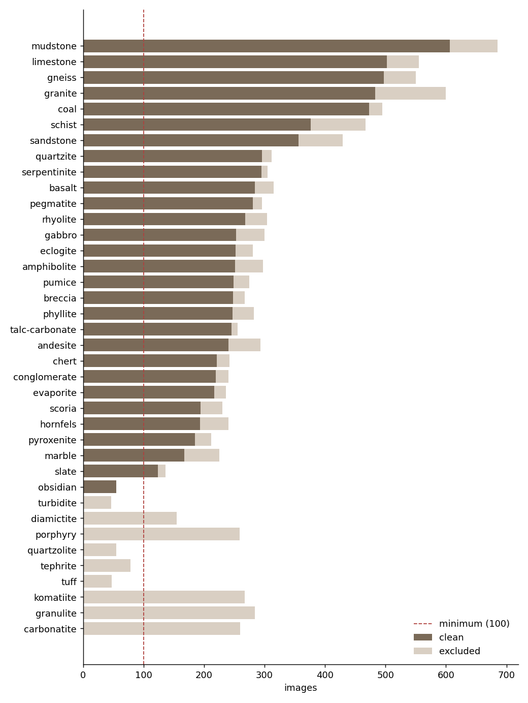
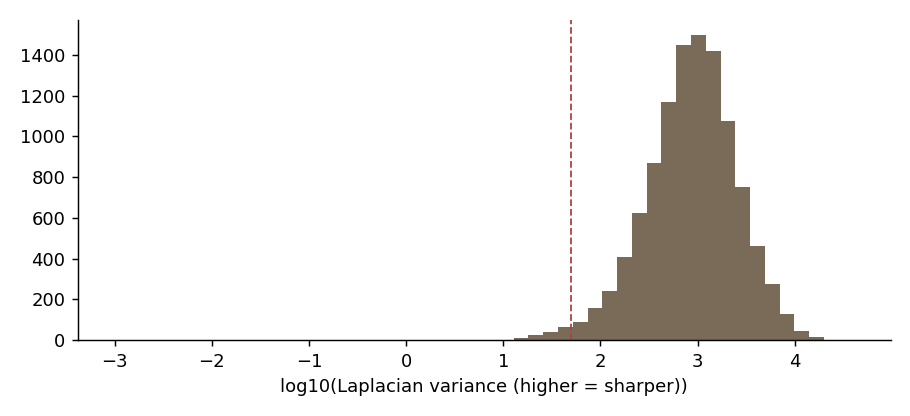
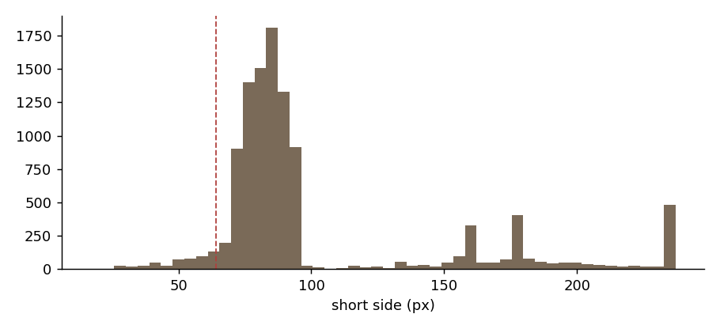
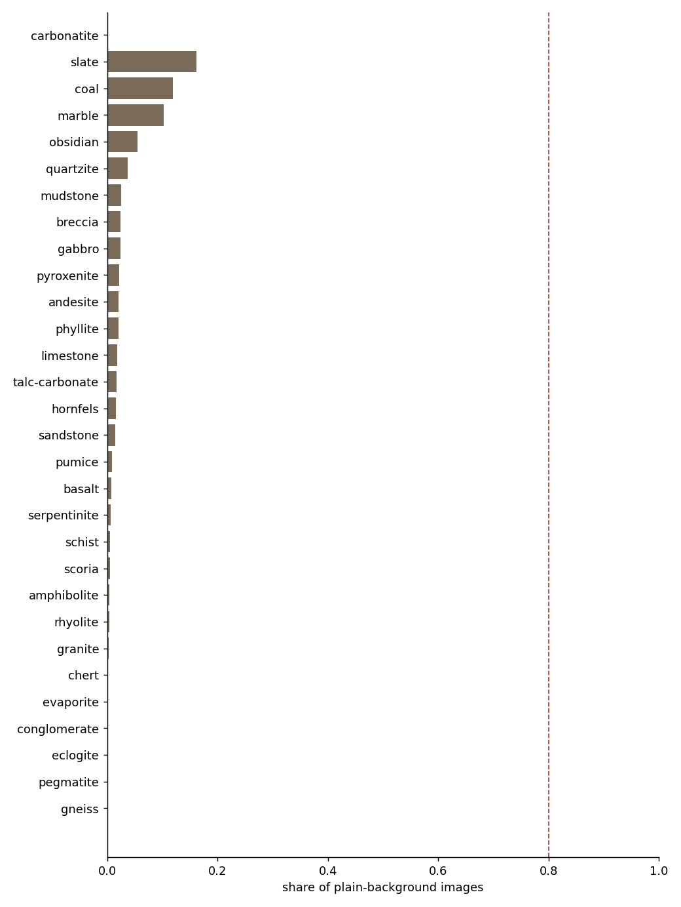

# RockID dataset audit

Generated 2026-11-01 10:06 UTC · dataset `kutlayusta/type-of-rocks-and-minerals-dataset`

## Summary

- **Images found:** 10,830
- **Classes:** 51 (from 51 raw names) → 29 kept
- **Decode errors:** 0
- **Clean images:** 8,277 (76%)
- **Excluded:** {'dropped_class': 1451, 'cross_class_duplicate': 776, 'too_small': 291, 'exact_duplicate': 35}
- **Classes below minimum:** none
- **Splits:** {'train': 5809, 'test': 1235, 'val': 1233}
- **Leakage check:** passed (no duplicate cluster spans two splits)
- **Field set:** missing

## License

- Kaggle license field: **not stated**

Images in this dataset appear to be collected from the web, so the dataset license may not cover the copyright of each image. RockID uses them **for training and evaluation only**. They are never redistributed, shown in the app, or used as encyclopedia images. Encyclopedia images come from Wikimedia Commons with per-image licenses (Phase 8).

## Label source

Labels come from each file name (`100Andesite.png` → `andesite`). The parent folder is kept as the `family` column. Pre-made split folders (train/test/valid) are ignored, because we re-split.

## Classes



| class | family | raw_names | total | clean | train | val | test | exact_duplicate | cross_class_duplicate | decode_error | too_small | plain_bg_share | blurry_share | probe_recall | nearest_class | nearest_sim | status |
|---|---|---|---|---|---|---|---|---|---|---|---|---|---|---|---|---|---|
| mudstone | sedimentary | Mudstone, Oil_shale, Shale, Siltstone | 685 | 606 | 428 | 74 | 104 | 6 | 42 | 0 | 31 | 0.02 | 0.02 | 0.17 | sandstone | 0.98 | ok |
| limestone | igneous, sedimentary | Chalk, Limestone, Oolite, Wackestone | 555 | 502 | 353 | 84 | 65 | 7 | 31 | 0 | 15 | 0.02 | 0.01 | 0.27 | mudstone | 0.98 | ok |
| gneiss | metamorphic | Gneiss, Migmatite | 550 | 497 | 346 | 72 | 79 | 0 | 34 | 0 | 19 | 0.00 | 0.00 | 0.37 | schist | 0.99 | ok |
| granite | igneous | Granite, Quartz_diorite, Quartz_monzonite | 600 | 483 | 328 | 74 | 81 | 0 | 97 | 0 | 20 | 0.00 | 0.00 | 0.33 | amphibolite | 0.97 | ok |
| coal | metamorphic, sedimentary | Anthracite, Coal | 495 | 473 | 350 | 53 | 70 | 11 | 2 | 0 | 9 | 0.12 | 0.07 | 0.73 | hornfels | 0.96 | ok |
| schist | metamorphic | Blueschist, Greenschist | 467 | 376 | 269 | 49 | 58 | 5 | 39 | 0 | 47 | 0.01 | 0.01 | 0.11 | gneiss | 0.99 | ok |
| sandstone | sedimentary | Greywacke, Sandstone | 429 | 356 | 231 | 62 | 63 | 0 | 52 | 0 | 21 | 0.01 | 0.01 | 0.42 | mudstone | 0.98 | ok |
| quartzite | metamorphic | Quartzite | 312 | 296 | 205 | 46 | 45 | 0 | 15 | 0 | 1 | 0.04 | 0.06 | 0.38 | marble | 0.97 | ok |
| serpentinite | metamorphic | Serpentinite | 305 | 295 | 197 | 54 | 44 | 0 | 6 | 0 | 4 | 0.01 | 0.00 | 0.50 | schist | 0.98 | ok |
| basalt | igneous | Basalt | 315 | 284 | 192 | 55 | 37 | 0 | 23 | 0 | 8 | 0.01 | 0.00 | 0.52 | mudstone | 0.96 | ok |
| pegmatite | igneous | Pegmatite | 296 | 281 | 193 | 46 | 42 | 0 | 10 | 0 | 5 | 0.00 | 0.01 | 0.36 | evaporite | 0.97 | ok |
| rhyolite | igneous | Rhyolite | 304 | 268 | 206 | 37 | 25 | 0 | 31 | 0 | 5 | 0.00 | 0.00 | 0.25 | pegmatite | 0.97 | ok |
| gabbro | igneous | Gabbro | 300 | 253 | 171 | 35 | 47 | 0 | 41 | 0 | 6 | 0.02 | 0.00 | 0.37 | amphibolite | 0.98 | ok |
| eclogite | metamorphic | Eclogite | 281 | 252 | 191 | 30 | 31 | 0 | 22 | 0 | 7 | 0.00 | 0.00 | 0.58 | pyroxenite | 0.96 | ok |
| amphibolite | metamorphic | Amphibolite | 297 | 251 | 180 | 38 | 33 | 0 | 34 | 0 | 12 | 0.00 | 0.00 | 0.20 | pyroxenite | 0.99 | ok |
| pumice | igneous | Pumice | 275 | 249 | 174 | 38 | 37 | 0 | 24 | 0 | 2 | 0.01 | 0.00 | 0.69 | scoria | 0.93 | ok |
| breccia | sedimentary | Breccia | 267 | 248 | 183 | 33 | 32 | 0 | 12 | 0 | 7 | 0.02 | 0.06 | 0.53 | marble | 0.96 | ok |
| phyllite | metamorphic | Phyllite | 282 | 247 | 168 | 41 | 38 | 0 | 30 | 0 | 5 | 0.02 | 0.00 | 0.24 | gneiss | 0.98 | ok |
| talc-carbonate | metamorphic | Talc_carbonate | 255 | 245 | 172 | 39 | 34 | 0 | 9 | 0 | 1 | 0.02 | 0.05 | 0.53 | limestone | 0.96 | ok |
| andesite | igneous | Andesite | 293 | 240 | 173 | 30 | 37 | 0 | 48 | 0 | 5 | 0.02 | 0.00 | 0.27 | pyroxenite | 0.98 | ok |
| chert | sedimentary | Chert, Flint | 242 | 221 | 146 | 39 | 36 | 6 | 5 | 0 | 10 | 0.00 | 0.02 | 0.29 | mudstone | 0.97 | ok |
| conglomerate | sedimentary | Conglomerate | 240 | 219 | 160 | 35 | 24 | 0 | 15 | 0 | 6 | 0.00 | 0.00 | 0.48 | rhyolite | 0.97 | ok |
| evaporite | sedimentary | Evaporite | 236 | 217 | 149 | 39 | 29 | 0 | 9 | 0 | 10 | 0.00 | 0.01 | 0.21 | pegmatite | 0.97 | ok |
| scoria | igneous | Scoria | 230 | 194 | 132 | 28 | 34 | 0 | 30 | 0 | 6 | 0.01 | 0.00 | 0.43 | granite | 0.97 | ok |
| hornfels | metamorphic | Hornfels | 240 | 193 | 143 | 23 | 27 | 0 | 27 | 0 | 20 | 0.02 | 0.01 | 0.19 | schist | 0.98 | ok |
| pyroxenite | igneous | Pyroxenite | 212 | 185 | 134 | 26 | 25 | 0 | 21 | 0 | 6 | 0.02 | 0.01 | 0.15 | amphibolite | 0.99 | ok |
| marble | metamorphic | Marble | 225 | 167 | 117 | 26 | 24 | 0 | 57 | 0 | 1 | 0.10 | 0.08 | 0.45 | quartzite | 0.97 | ok |
| slate | metamorphic | Slate | 136 | 124 | 77 | 21 | 26 | 0 | 10 | 0 | 2 | 0.16 | 0.06 | 0.49 | mudstone | 0.95 | ok |
| obsidian | igneous | Obsidian | 55 | 55 | 41 | 6 | 8 | 0 | 0 | 0 | 0 | 0.05 | 0.00 | 0.78 | chert | 0.87 | ok (exception) |
| carbonatite | igneous | Carbonatite | 260 | 0 | 0 | 0 | 0 | 0 | 0 | 0 | 0 |  |  |  |  |  | dropped |
| granulite | metamorphic | Granulite | 284 | 0 | 0 | 0 | 0 | 0 | 0 | 0 | 0 |  |  |  |  |  | dropped |
| komatiite | igneous | Komatiite | 267 | 0 | 0 | 0 | 0 | 0 | 0 | 0 | 0 |  |  |  |  |  | dropped |
| diamictite | sedimentary | Diamictite | 155 | 0 | 0 | 0 | 0 | 0 | 0 | 0 | 0 |  |  |  |  |  | dropped |
| porphyry | igneous | Porphyry | 259 | 0 | 0 | 0 | 0 | 0 | 0 | 0 | 0 |  |  |  |  |  | dropped |
| quartzolite | igneous | Quartzolite | 55 | 0 | 0 | 0 | 0 | 0 | 0 | 0 | 0 |  |  |  |  |  | dropped |
| tephrite | igneous | Tephrite | 78 | 0 | 0 | 0 | 0 | 0 | 0 | 0 | 0 |  |  |  |  |  | dropped |
| tuff | igneous | Tuff | 47 | 0 | 0 | 0 | 0 | 0 | 0 | 0 | 0 |  |  |  |  |  | dropped |
| turbidite | sedimentary | Turbidite | 46 | 0 | 0 | 0 | 0 | 0 | 0 | 0 | 0 |  |  |  |  |  | dropped |

## Duplicates

- Exact-duplicate groups: 117
- Near-duplicate pairs (pHash): 1555
- Near-duplicate pairs (embedding): 508
- Clusters with more than one image: 1016
- Images in such clusters: 2310
- Largest cluster: 22

Near-duplicates are grouped into clusters; a cluster always lands in a single split. Exact copies keep one image.

## Quality





## Background bias



Share of images per class whose border is nearly one color (studio or plain-backdrop shots). This is a heuristic; the contact sheets show what it means in practice.

Background-only linear probe (center 70% hidden): top-1 **31.7%** vs chance 3.4%.

## Linear probe (frozen MobileNetV2 features, 5-fold group CV)

- top-1 **37.3%**, top-3 **60.1%**, chance 3.4%, majority class 7.3%
- A rough floor for fine-tuning, not a forecast of the final score.

Most frequent confusions (share of the true class):

| true | pred | count | share_of_true |
|---|---|---|---|
| schist | serpentinite | 43 | 0.11 |
| marble | quartzite | 19 | 0.11 |
| andesite | gabbro | 27 | 0.11 |
| quartzite | marble | 33 | 0.11 |
| breccia | marble | 27 | 0.11 |
| scoria | pumice | 21 | 0.11 |
| marble | breccia | 18 | 0.11 |
| amphibolite | gabbro | 27 | 0.11 |
| pyroxenite | gabbro | 19 | 0.10 |
| phyllite | gneiss | 25 | 0.10 |
| evaporite | talc-carbonate | 20 | 0.09 |
| obsidian | coal | 5 | 0.09 |
| granite | gabbro | 43 | 0.09 |
| amphibolite | gneiss | 22 | 0.09 |
| gneiss | phyllite | 42 | 0.08 |

## Field test set

No field set found. Add real-world photos to `MyDrive/RockID/field_test/<class>/` (10–20 per class) before Phase 2: the gate needs them.

## Recommendations

- Imbalance ratio is 11.0x (largest/smallest class). Use class weights, and consider capping the largest classes.
- 327 duplicate clusters carry more than one label (label noise). Review `review/cross_class.jpg`; they are excluded from the splits.
- Linear probe on frozen features: top-1 37.3%, top-3 60.1% (chance 3.4%). This is a rough floor for fine-tuning, not a prediction of the final score.
- Background-only probe: top-1 31.7% with the specimen hidden. That is 84% of the full probe's gain over chance, so the risk that backgrounds act as a shortcut is HIGH. The field test set is what settles it.
- Caveat: most images here are close-ups where the rock fills the frame (few plain backgrounds), so the "background-only" view mostly shows rock texture too. The background probe overstates the shortcut risk for this dataset; trust the field test set instead.
- **mudstone**: probe recall 17%: at risk of failing the 50% recall gate; most similar class is `sandstone` (similarity 0.98).
- **limestone**: probe recall 27%: at risk of failing the 50% recall gate; most similar class is `mudstone` (similarity 0.98).
- **gneiss**: probe recall 37%: at risk of failing the 50% recall gate; most similar class is `schist` (similarity 0.99).
- **granite**: probe recall 33%: at risk of failing the 50% recall gate; most similar class is `amphibolite` (similarity 0.97); 16% duplicates removed.
- **schist**: probe recall 11%: at risk of failing the 50% recall gate; most similar class is `gneiss` (similarity 0.99).
- **sandstone**: probe recall 42%: at risk of failing the 50% recall gate; most similar class is `mudstone` (similarity 0.98); 12% duplicates removed.
- **quartzite**: probe recall 38%: at risk of failing the 50% recall gate; most similar class is `marble` (similarity 0.97).
- **pegmatite**: probe recall 36%: at risk of failing the 50% recall gate; most similar class is `evaporite` (similarity 0.97).
- **rhyolite**: probe recall 25%: at risk of failing the 50% recall gate; most similar class is `pegmatite` (similarity 0.97); 10% duplicates removed.
- **gabbro**: probe recall 37%: at risk of failing the 50% recall gate; most similar class is `amphibolite` (similarity 0.98); 14% duplicates removed.
- **amphibolite**: probe recall 20%: at risk of failing the 50% recall gate; most similar class is `pyroxenite` (similarity 0.99); 11% duplicates removed.
- **phyllite**: probe recall 24%: at risk of failing the 50% recall gate; most similar class is `gneiss` (similarity 0.98); 11% duplicates removed.
- **andesite**: probe recall 27%: at risk of failing the 50% recall gate; most similar class is `pyroxenite` (similarity 0.98); 16% duplicates removed.
- **chert**: probe recall 29%: at risk of failing the 50% recall gate; most similar class is `mudstone` (similarity 0.97).
- **conglomerate**: probe recall 48%: at risk of failing the 50% recall gate; most similar class is `rhyolite` (similarity 0.97).
- **evaporite**: probe recall 21%: at risk of failing the 50% recall gate; most similar class is `pegmatite` (similarity 0.97).
- **scoria**: probe recall 43%: at risk of failing the 50% recall gate; most similar class is `granite` (similarity 0.97); 13% duplicates removed.
- **hornfels**: probe recall 19%: at risk of failing the 50% recall gate; most similar class is `schist` (similarity 0.98); 11% duplicates removed.
- **pyroxenite**: probe recall 15%: at risk of failing the 50% recall gate; most similar class is `amphibolite` (similarity 0.99).
- **marble**: probe recall 45%: at risk of failing the 50% recall gate; most similar class is `quartzite` (similarity 0.97); 25% duplicates removed.
- **slate**: probe recall 49%: at risk of failing the 50% recall gate; most similar class is `mudstone` (similarity 0.95).

## Review before approving the class list

Contact sheets are in `review/`. **Do not commit `review/`**: it contains dataset images.

- `review/classes/amphibolite.jpg`
- `review/classes/andesite.jpg`
- `review/classes/basalt.jpg`
- `review/classes/breccia.jpg`
- `review/classes/chert.jpg`
- `review/classes/coal.jpg`
- `review/classes/conglomerate.jpg`
- `review/classes/eclogite.jpg`
- `review/classes/evaporite.jpg`
- `review/classes/gabbro.jpg`
- `review/classes/gneiss.jpg`
- `review/classes/granite.jpg`
- `review/classes/hornfels.jpg`
- `review/classes/limestone.jpg`
- `review/classes/marble.jpg`
- `review/classes/mudstone.jpg`
- `review/classes/obsidian.jpg`
- `review/classes/pegmatite.jpg`
- `review/classes/phyllite.jpg`
- `review/classes/pumice.jpg`
- `review/classes/pyroxenite.jpg`
- `review/classes/quartzite.jpg`
- `review/classes/rhyolite.jpg`
- `review/classes/sandstone.jpg`
- `review/classes/schist.jpg`
- `review/classes/scoria.jpg`
- `review/classes/serpentinite.jpg`
- `review/classes/slate.jpg`
- `review/classes/talc-carbonate.jpg`
- `review/clusters_largest.jpg`
- `review/cross_class.jpg`
- `review/threshold_edge_pairs.jpg`
- `review/blurriest.jpg`
- `review/background_most_vs_least_plain.jpg`

To merge or drop classes, set `class_merges` / `drop_classes` in the notebook config and re-run from the split step.

## Config

```json
{
  "kaggle_dataset": "kutlayusta/type-of-rocks-and-minerals-dataset",
  "seed": 42,
  "label_from": "filename",
  "val_frac": 0.15,
  "test_frac": 0.15,
  "min_images_per_class": 100,
  "min_side": 64,
  "phash_max_dist": 6,
  "emb_min_sim": 0.95,
  "plain_tol": 24.0,
  "plain_frac_threshold": 0.85,
  "studio_class_warn": 0.8,
  "blur_low": 50.0,
  "exclude_cross_class": true,
  "class_merges": {
    "quartz-monzonite": "granite",
    "quartz-diorite": "granite",
    "migmatite": "gneiss",
    "greenschist": "schist",
    "blueschist": "schist",
    "anthracite": "coal",
    "flint": "chert",
    "siltstone": "mudstone",
    "shale": "mudstone",
    "oil-shale": "mudstone",
    "wackestone": "limestone",
    "oolite": "limestone",
    "chalk": "limestone",
    "greywacke": "sandstone"
  },
  "drop_classes": [
    "granulite",
    "carbonatite",
    "komatiite",
    "porphyry",
    "quartzolite",
    "tephrite",
    "turbidite",
    "diamictite",
    "tuff"
  ],
  "keep_below_min": [
    "obsidian"
  ],
  "background_probe": true,
  "embed_size": 224
}
```
