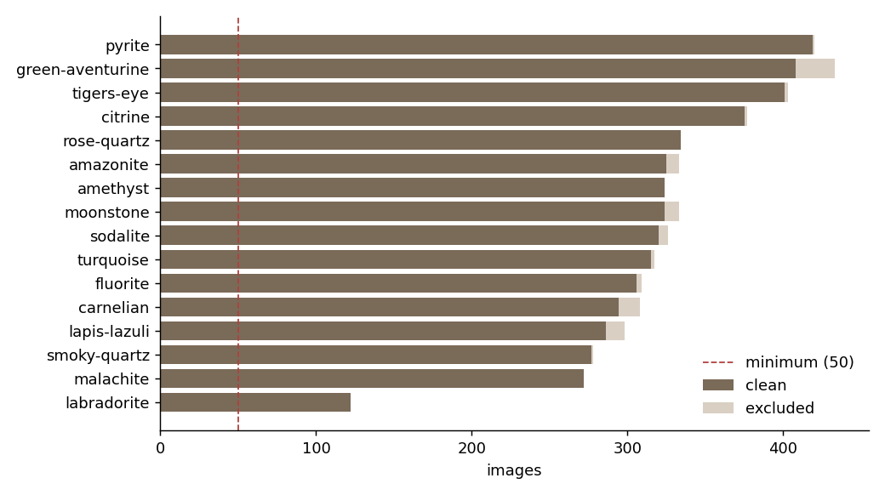
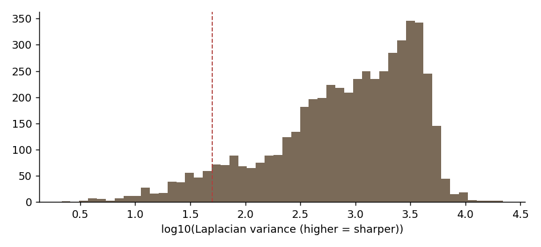
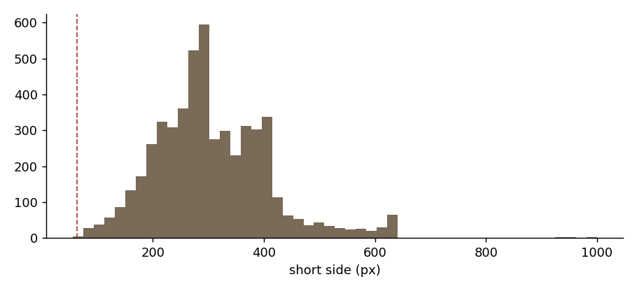
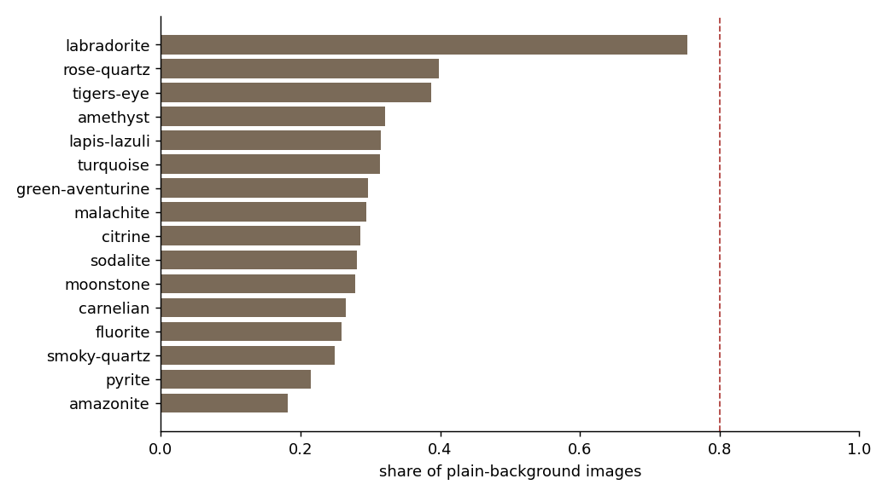

# RockID dataset audit

Generated 2026-11-01 14:48 UTC · dataset `kutlayusta/type-of-rocks-and-minerals-dataset`

## Summary

- **Sources:** kaggle-gemstones-images: 3,219 images; roboflow-crystals-yddoa: 18,883 images; roboflow-gemstone-classification: 5,356 images
- **Source errors:** commons: HTTPError: HTTP Error 429: Your bot is making too many requests. Please reduce your request rate or contact bot-traffic@wikimedia.org (f263c81)
- **Matched to our stones:** 5,187 images from 47 source classes
- **Clean images:** 5,102
- **Excluded:** {'cross_class_duplicate': 71, 'exact_duplicate': 7, 'decode_error': 4, 'too_small': 3}
- **Stones below minimum:** none
- **Stones with no images:** clear-quartz, black-obsidian, black-tourmaline, hematite
- **Splits:** {'train': 3571, 'val': 768, 'test': 763}
- **Leakage check:** passed (no duplicate cluster spans two splits)

## License

- Kaggle metadata could not be read. Check the dataset page by hand.

Images in this dataset appear to be collected from the web, so the dataset license may not cover the copyright of each image. RockID uses them **for training and evaluation only**. They are never redistributed, shown in the app, or used as encyclopedia images. Encyclopedia images come from Wikimedia Commons with per-image licenses (Phase 8).

## Label source

Labels come from each image's parent folder name, slugified. Pre-made split folders (train/test/valid) are ignored, because we re-split.

Folder names that collapsed into one class (check these are really the same class):

- `amazonite` ← Amazonite, amazonite
- `amethyst` ← Amethyst, amethyst
- `carnelian` ← Carnelian, carnelian
- `citrine` ← Citrine, citrine
- `fluorite` ← Fluorite, fluorite
- `green-aventurine` ← Aventurine Green, green_aventurine
- `lapis-lazuli` ← Lapis Lazuli, lapis_lazuli
- `malachite` ← Malachite, malachite
- `moonstone` ← Moonstone, moonstone
- `pyrite` ← Pyrite, pyrite
- `rose-quartz` ← Quartz Rose, rose_quartz
- `smoky-quartz` ← Quartz Smoky, smoky_quartz
- `sodalite` ← Sodalite, sodalite
- `tigers-eye` ← Tigers Eye, tigers_eye
- `turquoise` ← Turquoise, turquoise

## Classes



| class | family | raw_names | total | clean | train | val | test | exact_duplicate | cross_class_duplicate | decode_error | too_small | plain_bg_share | blurry_share | probe_recall | nearest_class | nearest_sim | status |
|---|---|---|---|---|---|---|---|---|---|---|---|---|---|---|---|---|---|
| amethyst | kaggle-gemstones-images, roboflow-crystals-yddoa, roboflow-gemstone-classification | Amethyst, amethyst | 324.00 | 324.00 | 230.00 | 47.00 | 47.00 | 0.00 | 0.00 | 0.00 | 0.00 | 0.32 | 0.02 | 0.85 | smoky-quartz | 0.94 | ok |
| rose-quartz | kaggle-gemstones-images, roboflow-crystals-yddoa, roboflow-gemstone-classification | Quartz Rose, rose_quartz | 334.00 | 334.00 | 235.00 | 55.00 | 44.00 | 0.00 | 0.00 | 0.00 | 0.00 | 0.40 | 0.19 | 0.88 | moonstone | 0.92 | ok |
| citrine | kaggle-gemstones-images, roboflow-crystals-yddoa, roboflow-gemstone-classification | Citrine, citrine | 377.00 | 375.00 | 261.00 | 59.00 | 55.00 | 0.00 | 2.00 | 0.00 | 0.00 | 0.29 | 0.04 | 0.97 | smoky-quartz | 0.91 | ok |
| smoky-quartz | kaggle-gemstones-images, roboflow-crystals-yddoa, roboflow-gemstone-classification | Quartz Smoky, smoky_quartz | 278.00 | 277.00 | 189.00 | 42.00 | 46.00 | 0.00 | 1.00 | 0.00 | 0.00 | 0.25 | 0.03 | 0.86 | amethyst | 0.94 | ok |
| tigers-eye | kaggle-gemstones-images, roboflow-crystals-yddoa, roboflow-gemstone-classification | Tigers Eye, tigers_eye | 403.00 | 401.00 | 283.00 | 57.00 | 61.00 | 0.00 | 2.00 | 0.00 | 0.00 | 0.39 | 0.01 | 0.94 | fluorite | 0.88 | ok |
| malachite | kaggle-gemstones-images, roboflow-crystals-yddoa, roboflow-gemstone-classification | Malachite, malachite | 272.00 | 272.00 | 193.00 | 35.00 | 44.00 | 0.00 | 0.00 | 0.00 | 0.00 | 0.29 | 0.06 | 0.82 | fluorite | 0.94 | ok |
| lapis-lazuli | kaggle-gemstones-images, roboflow-crystals-yddoa, roboflow-gemstone-classification | Lapis Lazuli, lapis_lazuli | 298.00 | 286.00 | 206.00 | 42.00 | 38.00 | 3.00 | 8.00 | 0.00 | 1.00 | 0.31 | 0.01 | 0.90 | sodalite | 0.93 | ok |
| labradorite | kaggle-gemstones-images, roboflow-gemstone-classification | Labradorite | 122.00 | 122.00 | 86.00 | 19.00 | 17.00 | 0.00 | 0.00 | 0.00 | 0.00 | 0.75 | 0.02 | 0.94 | lapis-lazuli | 0.88 | ok |
| green-aventurine | kaggle-gemstones-images, roboflow-crystals-yddoa, roboflow-gemstone-classification | Aventurine Green, green_aventurine | 433.00 | 408.00 | 279.00 | 62.00 | 67.00 | 0.00 | 25.00 | 0.00 | 0.00 | 0.30 | 0.10 | 0.88 | amazonite | 0.92 | ok |
| turquoise | kaggle-gemstones-images, roboflow-crystals-yddoa, roboflow-gemstone-classification | Turquoise, turquoise | 317.00 | 315.00 | 220.00 | 49.00 | 46.00 | 0.00 | 0.00 | 1.00 | 1.00 | 0.31 | 0.07 | 0.91 | amazonite | 0.94 | ok |
| amazonite | kaggle-gemstones-images, roboflow-crystals-yddoa, roboflow-gemstone-classification | Amazonite, amazonite | 333.00 | 325.00 | 225.00 | 51.00 | 49.00 | 3.00 | 4.00 | 1.00 | 0.00 | 0.18 | 0.12 | 0.80 | fluorite | 0.95 | ok |
| sodalite | kaggle-gemstones-images, roboflow-crystals-yddoa, roboflow-gemstone-classification | Sodalite, sodalite | 326.00 | 320.00 | 226.00 | 49.00 | 45.00 | 0.00 | 5.00 | 0.00 | 1.00 | 0.28 | 0.04 | 0.88 | lapis-lazuli | 0.93 | ok |
| pyrite | kaggle-gemstones-images, roboflow-crystals-yddoa, roboflow-gemstone-classification | Pyrite, pyrite | 420.00 | 419.00 | 296.00 | 60.00 | 63.00 | 0.00 | 0.00 | 1.00 | 0.00 | 0.21 | 0.01 | 0.88 | smoky-quartz | 0.94 | ok |
| carnelian | kaggle-gemstones-images, roboflow-crystals-yddoa, roboflow-gemstone-classification | Carnelian, carnelian | 308.00 | 294.00 | 206.00 | 47.00 | 41.00 | 0.00 | 14.00 | 0.00 | 0.00 | 0.27 | 0.17 | 0.98 | moonstone | 0.91 | ok |
| moonstone | kaggle-gemstones-images, roboflow-crystals-yddoa, roboflow-gemstone-classification | Moonstone, moonstone | 333.00 | 324.00 | 224.00 | 51.00 | 49.00 | 0.00 | 9.00 | 0.00 | 0.00 | 0.28 | 0.08 | 0.88 | rose-quartz | 0.92 | ok |
| fluorite | kaggle-gemstones-images, roboflow-crystals-yddoa, roboflow-gemstone-classification | Fluorite, fluorite | 309.00 | 306.00 | 212.00 | 43.00 | 51.00 | 1.00 | 1.00 | 1.00 | 0.00 | 0.26 | 0.06 | 0.79 | amazonite | 0.95 | ok |

## Duplicates

- Exact-duplicate groups: 9
- Near-duplicate pairs (pHash): 269
- Near-duplicate pairs (embedding): 280
- Clusters with more than one image: 221
- Clusters spanning two or more sources: 180
- Largest cluster: 28

Near-duplicates are grouped into clusters; a cluster always lands in a single split. Exact copies keep one image.

## Quality





## Background bias



Share of images per class whose border is nearly one color (studio or plain-backdrop shots). This is a heuristic; the contact sheets show what it means in practice.

Background-only linear probe (center 70% hidden): top-1 **61.8%** vs chance 6.2%.

## Linear probe (frozen MobileNetV2 features, 5-fold group CV)

- top-1 **88.6%**, top-3 **97.5%**, chance 6.2%, majority class 8.2%
- A rough floor for fine-tuning, not a forecast of the final score.

Most frequent confusions (share of the true class):

| true | pred | count | share_of_true |
|---|---|---|---|
| amethyst | green-aventurine | 19 | 0.06 |
| green-aventurine | amazonite | 23 | 0.06 |
| smoky-quartz | pyrite | 14 | 0.05 |
| malachite | fluorite | 13 | 0.05 |
| sodalite | lapis-lazuli | 15 | 0.05 |
| amazonite | turquoise | 14 | 0.04 |
| fluorite | sodalite | 13 | 0.04 |
| fluorite | amazonite | 13 | 0.04 |
| malachite | amazonite | 10 | 0.04 |
| pyrite | smoky-quartz | 15 | 0.04 |
| turquoise | amazonite | 11 | 0.03 |
| moonstone | rose-quartz | 11 | 0.03 |
| malachite | green-aventurine | 9 | 0.03 |
| moonstone | carnelian | 10 | 0.03 |
| amazonite | fluorite | 10 | 0.03 |

## Field test set

No field set found. Add real-world photos to `MyDrive/RockID/field_test/<class>/` (10–20 per class) before Phase 2: the gate needs them.

## Recommendations

- No images at all for: clear-quartz, black-obsidian, black-tourmaline, hematite. Add aliases or another source.
- 15 duplicate clusters carry more than one label (label noise). Review `review/cross_class.jpg`; they are excluded from the splits.
- Linear probe on frozen features: top-1 88.6%, top-3 97.5% (chance 6.2%). This is a rough floor for fine-tuning, not a prediction of the final score.
- Background-only probe: top-1 61.8% with the specimen hidden. That is 68% of the full probe's gain over chance, so the risk that backgrounds act as a shortcut is HIGH. The field test set is what settles it.
- **labradorite**: only 17 test images: per-class metrics will be noisy.

## Review before approving the class list

Contact sheets are in `review/`. **Do not commit `review/`**: it contains dataset images.

- `review/stones/amazonite.jpg`
- `review/stones/amethyst.jpg`
- `review/stones/carnelian.jpg`
- `review/stones/citrine.jpg`
- `review/stones/fluorite.jpg`
- `review/stones/green-aventurine.jpg`
- `review/stones/labradorite.jpg`
- `review/stones/lapis-lazuli.jpg`
- `review/stones/malachite.jpg`
- `review/stones/moonstone.jpg`
- `review/stones/pyrite.jpg`
- `review/stones/rose-quartz.jpg`
- `review/stones/smoky-quartz.jpg`
- `review/stones/sodalite.jpg`
- `review/stones/tigers-eye.jpg`
- `review/stones/turquoise.jpg`
- `review/cross_class.jpg`

To merge or drop classes, set `class_merges` / `drop_classes` in the notebook config and re-run from the split step.

## Config

```json
{
  "kaggle_dataset": "kutlayusta/type-of-rocks-and-minerals-dataset",
  "seed": 42,
  "label_from": "folder",
  "val_frac": 0.15,
  "test_frac": 0.15,
  "min_images_per_class": 50,
  "min_side": 64,
  "phash_max_dist": 6,
  "emb_min_sim": 0.95,
  "plain_tol": 24.0,
  "plain_frac_threshold": 0.85,
  "studio_class_warn": 0.8,
  "blur_low": 50.0,
  "exclude_cross_class": true,
  "class_merges": {},
  "drop_classes": [],
  "keep_below_min": [],
  "background_probe": true,
  "embed_size": 224,
  "stone_file": "configs/stones_v1.json",
  "roboflow": {
    "kaggle-gemstones-images": {
      "dataset": "lsind18/gemstones-images"
    },
    "roboflow-crystals-yddoa": {
      "project": "connaisseur-llc/crystals-yddoa",
      "type": "object-detection",
      "images": 2826,
      "version": 1,
      "license": "CC BY 4.0",
      "classes": {
        "chrysocolla": 39,
        "red_onyx": 34,
        "pink_sapphire": 30,
        "scapolite": 37,
        "chrysoberyl": 31,
        "andranite": 31,
        "pyrope": 30,
        "chrome diopside": 38,
        "bloodstone": 35,
        "rhodonite": 32,
        "cats_eye": 31,
        "pyrite": 43,
        "kunzite": 33,
        "tourmaline": 38,
        "yellow_aventurine": 123,
        "chrysoprase": 36,
        "green_aventurine": 45,
        "tanzanite": 37,
        "bixbite": 36,
        "coral": 31,
        "fluorite": 34,
        "diaspore": 31,
        "chalcedony": 30,
        "amazonite": 36,
        "pearl": 15,
        "kyanite": 30,
        "black_onyx": 31,
        "beer_quartz": 34,
        "lemon_quartz": 33,
        "grossular": 30,
        "smoky_quartz": 31,
        "rose_quartz": 35,
        "sodalite": 35,
        "green_onyx": 30,
        "iolite": 33,
        "citrine": 40,
        "carnelian": 32,
        "sunstone": 30,
        "alexandrite": 34,
        "serpentine": 30,
        "emerald": 38,
        "purple_sapphire": 31,
        "prehnite": 36,
        "ametrine": 35,
        "hessonite": 27,
        "aquamarine": 36,
        "rutilated_quartz": 38,
        "rhodolite": 37,
        "jade": 31,
        "sphene": 28,
        "amethyst": 35,
        "turquoise": 32,
        "spodumene": 35,
        "morganite": 31,
        "hiddenite": 31,
        "zircon": 33,
        "yellow_sapphire": 31,
        "blue_lace_agate": 37,
        "spesartite": 30,
        "peridot": 39,
        "tigers_eye": 43,
        "danburite": 32,
        "topaz": 39,
        "lapis_lazuli": 32,
        "red_garnet": 36,
        "blue_sapphire": 34,
        "dumortierite": 50,
        "moonstone": 35,
        "golden_beryl": 35,
        "andalusite": 32,
        "goshenite": 31,
        "amber": 41,
        "larimar": 28,
        "malachite": 28,
        "rhodochrosite": 29,
        "ruby": 35,
        "jasper": 44,
        "tsavorite": 31,
        "spinel": 40,
        "diamond": 31,
        "blue_chalcedony": 32,
        "opal": 36,
        "variscite": 29,
        "benitoite": 31,
        "almandine": 32
      }
    },
    "roboflow-gemstone-classification": {
      "project": "fma04-fayoum-edu-eg/gemstone-classification",
      "type": "classification",
      "images": 2820,
      "version": 3,
      "license": "CC BY 4.0",
      "classes": {
        "Alexandrite": 33,
        "Almandine": 31,
        "Amazonite": 32,
        "Amber": 31,
        "Amethyst": 35,
        "Ametrine": 35,
        "Andalusite": 32,
        "Andradite": 31,
        "Aquamarine": 36,
        "Aventurine Green": 45,
        "Aventurine Yellow": 34,
        "Benitoite": 31,
        "Beryl Golden": 35,
        "Bixbite": 36,
        "Bloodstone": 35,
        "Blue Lace Agate": 37,
        "Carnelian": 31,
        "Cats Eye": 31,
        "Chalcedony": 30,
        "Chalcedony Blue": 29,
        "Chrome Diopside": 32,
        "Chrysoberyl": 31,
        "Chrysoprase": 30,
        "Chrysocolla": 36,
        "Citrine": 40,
        "Coral": 31,
        "Danburite": 32,
        "Diamond": 31,
        "Diaspore": 31,
        "Dumortierite": 32,
        "Emerald": 36,
        "Fluorite": 32,
        "Garnet Red": 32,
        "Goshenite": 31,
        "Grossular": 29,
        "Hessonite": 27,
        "Hiddenite": 29,
        "Iolite": 32,
        "Jade": 28,
        "Jasper": 36,
        "Kunzite": 32,
        "Kyanite": 29,
        "Labradorite": 40,
        "Lapis Lazuli": 31,
        "Larimar": 27,
        "Malachite": 28,
        "Moonstone": 36,
        "Morganite": 31,
        "Onyx Black": 27,
        "Onyx Green": 28,
        "Onyx Red": 28,
        "Opal": 36,
        "Pearl": 15,
        "Peridot": 39,
        "Prehnite": 37,
        "Pyrite": 43,
        "Pyrope": 31,
        "Quartz Beer": 35,
        "Quartz Lemon": 33,
        "Quartz Rose": 35,
        "Quartz Rutilated": 38,
        "Quartz Smoky": 30,
        "Rhodochrosite": 29,
        "Rhodolite": 36,
        "Rhodonite": 32,
        "Ruby": 35,
        "Sapphire Blue": 34,
        "Sapphire Pink": 30,
        "Sapphire Purple": 31,
        "Sapphire Yellow": 31,
        "Scapolite": 28,
        "Serpentine": 30,
        "Sodalite": 35,
        "Spessartite": 30,
        "Sphene": 28,
        "Spinel": 28,
        "Spodumene": 35,
        "Sunstone": 27,
        "Tanzanite": 36,
        "Tigers Eye": 43,
        "Topaz": 34,
        "Tourmaline": 38,
        "Tsavorite": 31,
        "Turquoise": 32,
        "Variscite": 29,
        "Zircon": 33,
        "Zoisite": 28
      }
    }
  }
}
```
