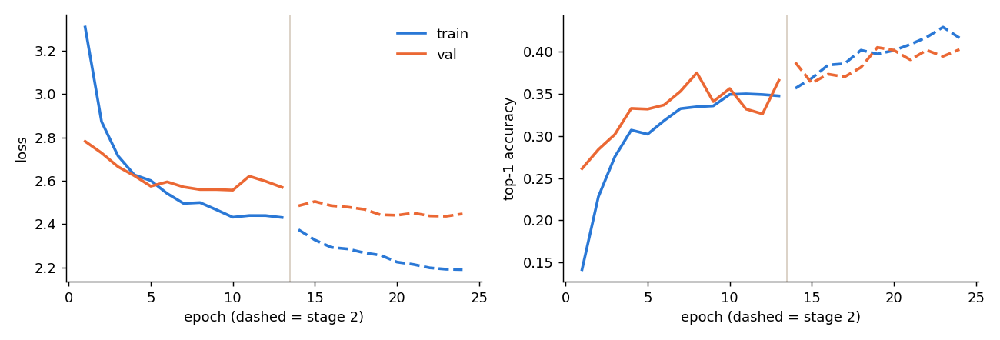
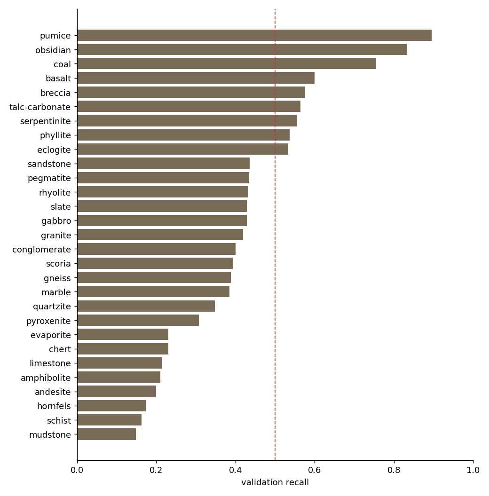

# RockID training run `mnv2-classes_v1-s42`

Generated 2026-11-01 11:31 UTC

## Summary

- **Data:** 8,277 images, 29 classes (splits/split_manifest_classes_v1.csv, class list v1)
- **Splits:** train 5,809 · val 1,233 · test 1,235 (test not used here)
- **Model:** mobilenet_v2 α 1.0, 224 px, logits output, in-graph normalization
- **Stage 1:** 13 epochs, best epoch 8 (val_top1 0.375)
- **Stage 2:** 11 epochs, best epoch 6 (val_top1 0.405)
- **Training time (this session):** 10 min
- **TF.js smoke test:** passed · float16 · 4.43 MB · max |Δp| 0.0020
- **Versions:** {"python": "3.13.16", "tensorflow": "2.21.0", "keras": "3.13.2", "numpy": "2.1.3", "converter": {"tensorflowjs": "4.22.0", "installed": ["tensorflowjs==4.22.0"]}, "node": {"node": "v22.23.4", "tfjs_npm": "4.22.0"}}

## Validation (indicative)

The best epoch was picked on validation, so these numbers lean optimistic. The gate itself is checked on the test and field sets in `03_evaluate`.

| metric | val | gate target | met on val |
|---|---|---|---|
| top-1 | 40.5% | ≥ 75.0% | no |
| top-3 | 61.3% | ≥ 90.0% | no |
| lowest class recall (mudstone) | 14.9% | ≥ 50.0% | no |




## Per-class validation recall

| index | recall | val_images | train_images | class_weight |
|---|---|---|---|---|
| mudstone | 0.15 | 74 | 428 | 0.47 |
| schist | 0.16 | 49 | 269 | 0.74 |
| hornfels | 0.17 | 23 | 143 | 1.40 |
| andesite | 0.20 | 30 | 173 | 1.16 |
| amphibolite | 0.21 | 38 | 180 | 1.11 |
| limestone | 0.21 | 84 | 353 | 0.57 |
| chert | 0.23 | 39 | 146 | 1.37 |
| evaporite | 0.23 | 39 | 149 | 1.34 |
| pyroxenite | 0.31 | 26 | 134 | 1.49 |
| quartzite | 0.35 | 46 | 205 | 0.98 |
| marble | 0.38 | 26 | 117 | 1.71 |
| gneiss | 0.39 | 72 | 346 | 0.58 |
| scoria | 0.39 | 28 | 132 | 1.52 |
| conglomerate | 0.40 | 35 | 160 | 1.25 |
| granite | 0.42 | 74 | 328 | 0.61 |
| gabbro | 0.43 | 35 | 171 | 1.17 |
| slate | 0.43 | 21 | 77 | 2.60 |
| rhyolite | 0.43 | 37 | 206 | 0.97 |
| pegmatite | 0.43 | 46 | 193 | 1.04 |
| sandstone | 0.44 | 62 | 231 | 0.87 |
| eclogite | 0.53 | 30 | 191 | 1.05 |
| phyllite | 0.54 | 41 | 168 | 1.19 |
| serpentinite | 0.56 | 54 | 197 | 1.02 |
| talc-carbonate | 0.56 | 39 | 172 | 1.16 |
| breccia | 0.58 | 33 | 183 | 1.09 |
| basalt | 0.60 | 55 | 192 | 1.04 |
| coal | 0.75 | 53 | 350 | 0.57 |
| obsidian | 0.83 | 6 | 41 | 4.89 |
| pumice | 0.89 | 38 | 174 | 1.15 |

## Most confused pairs (validation)

| true | pred | count | share_of_true |
|---|---|---|---|
| slate | phyllite | 4 | 0.19 |
| hornfels | phyllite | 4 | 0.17 |
| gneiss | phyllite | 12 | 0.17 |
| obsidian | slate | 1 | 0.17 |
| amphibolite | gneiss | 6 | 0.16 |
| pyroxenite | gabbro | 4 | 0.15 |
| marble | breccia | 4 | 0.15 |
| limestone | talc-carbonate | 12 | 0.14 |
| gabbro | granite | 5 | 0.14 |
| conglomerate | eclogite | 5 | 0.14 |
| amphibolite | gabbro | 5 | 0.13 |
| hornfels | granite | 3 | 0.13 |
| quartzite | breccia | 6 | 0.13 |
| hornfels | coal | 3 | 0.13 |
| sandstone | slate | 8 | 0.13 |

## Config

```json
{
  "run_name": "mnv2-classes_v1-s42",
  "split_manifest": "splits/split_manifest_classes_v1.csv",
  "class_file": "configs/classes_v1.json",
  "seed": 42,
  "arch": "mobilenet_v2",
  "alpha": 1.0,
  "image_size": 224,
  "prep_short_side": 288,
  "batch_size": 32,
  "dropout": 0.3,
  "label_smoothing": 0.1,
  "class_weight_power": 1.0,
  "crop_area_min": 0.5,
  "crop_aspect": [
    0.75,
    1.333
  ],
  "flips": true,
  "rot90": true,
  "brightness": 0.15,
  "contrast": 0.15,
  "saturation": 0.15,
  "hue": 0.02,
  "stage1_epochs": 15,
  "stage1_lr": 0.001,
  "unfreeze_frac": 0.3,
  "stage2_epochs": 30,
  "stage2_lr": 1e-05,
  "patience": 5,
  "monitor": "val_top1",
  "deterministic_ops": false,
  "tfjs_converter": "tensorflowjs==4.22.0",
  "tfjs_quantization": "float16",
  "tfjs_max_abs_diff": 0.02,
  "tfjs_npm": "@tensorflow/tfjs@4.22.0",
  "max_web_model_mb": 5.0
}
```
