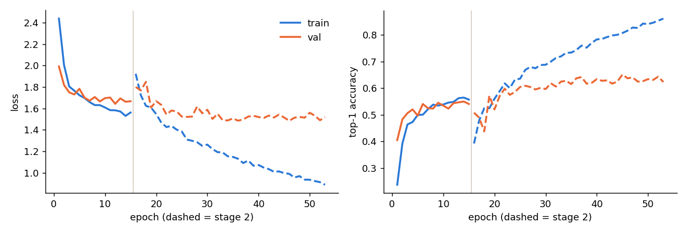
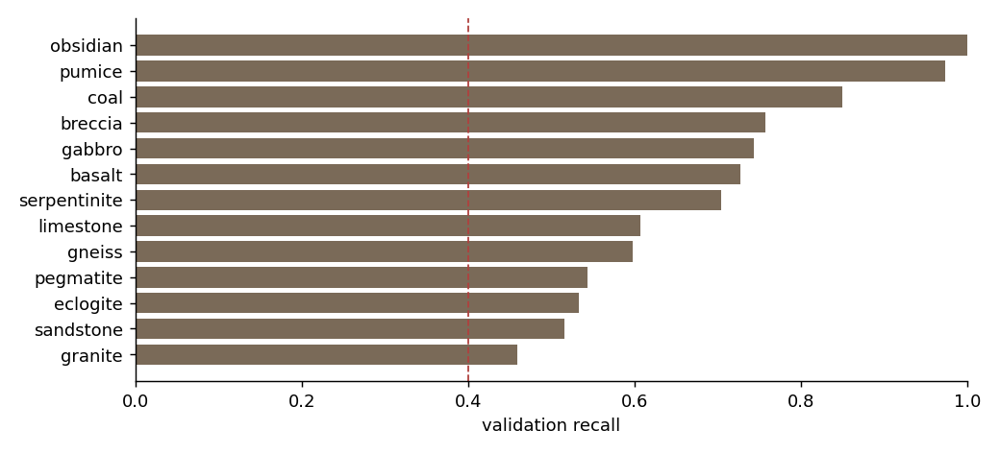

# RockID training run `mnv2-classes_v2-train_v3-s42`

Generated 2026-11-01 13:02 UTC

## Summary

- **Data:** 4,228 images, 13 classes (splits/split_manifest_classes_v2.csv, class list v2)
- **Splits:** train 2,950 · val 642 · test 636 (test not used here)
- **Model:** mobilenet_v2 α 1.0, 224 px, logits output, in-graph normalization
- **Stage 1:** 15 epochs, best epoch 14 (val_top1 0.550)
- **Stage 2:** 38 epochs, best epoch 30 (val_top1 0.651)
- **Training time (this session):** 15 min
- **TF.js smoke test:** passed · float16 · 4.39 MB · max |Δp| 0.0022
- **Versions:** {"python": "3.13.16", "tensorflow": "2.21.0", "keras": "3.13.2", "numpy": "2.1.3", "converter": {"tensorflowjs": "4.22.0", "installed": []}, "node": {"node": "v22.23.4", "tfjs_npm": "4.22.0"}}

## Validation (indicative)

The best epoch was picked on validation, so these numbers lean optimistic. The gate itself is checked on the test and field sets in `03_evaluate`.

| metric | val | gate target | met on val |
|---|---|---|---|
| top-1 | 65.1% | ≥ 60.0% | yes |
| top-3 | 86.3% | ≥ 80.0% | yes |
| lowest class recall (granite) | 45.9% | ≥ 40.0% | yes |




## Per-class validation recall

| index | recall | val_images | train_images | class_weight |
|---|---|---|---|---|
| granite | 0.46 | 74 | 328 | 0.69 |
| sandstone | 0.52 | 62 | 231 | 0.98 |
| eclogite | 0.53 | 30 | 191 | 1.19 |
| pegmatite | 0.54 | 46 | 193 | 1.18 |
| gneiss | 0.60 | 72 | 346 | 0.66 |
| limestone | 0.61 | 84 | 353 | 0.64 |
| serpentinite | 0.70 | 54 | 197 | 1.15 |
| basalt | 0.73 | 55 | 192 | 1.18 |
| gabbro | 0.74 | 35 | 171 | 1.33 |
| breccia | 0.76 | 33 | 183 | 1.24 |
| coal | 0.85 | 53 | 350 | 0.65 |
| pumice | 0.97 | 38 | 174 | 1.30 |
| obsidian | 1.00 | 6 | 41 | 5.53 |

## Most confused pairs (validation)

| true | pred | count | share_of_true |
|---|---|---|---|
| eclogite | gabbro | 5 | 0.17 |
| eclogite | serpentinite | 4 | 0.13 |
| sandstone | limestone | 8 | 0.13 |
| sandstone | gabbro | 8 | 0.13 |
| granite | pegmatite | 9 | 0.12 |
| sandstone | gneiss | 7 | 0.11 |
| gneiss | gabbro | 8 | 0.11 |
| basalt | gabbro | 6 | 0.11 |
| limestone | pumice | 8 | 0.10 |
| limestone | basalt | 8 | 0.10 |
| granite | gabbro | 7 | 0.09 |
| serpentinite | gneiss | 5 | 0.09 |
| breccia | limestone | 3 | 0.09 |
| pegmatite | limestone | 4 | 0.09 |
| granite | serpentinite | 6 | 0.08 |

## Config

```json
{
  "run_name": "mnv2-classes_v2-train_v3-s42",
  "split_manifest": "splits/split_manifest_classes_v2.csv",
  "class_file": "configs/classes_v2.json",
  "seed": 42,
  "arch": "mobilenet_v2",
  "alpha": 1.0,
  "image_size": 224,
  "prep_short_side": 288,
  "batch_size": 32,
  "dropout": 0.3,
  "label_smoothing": 0.1,
  "class_weight_power": 1.0,
  "crop_area_min": 0.5,
  "crop_aspect": [
    0.75,
    1.333
  ],
  "flips": true,
  "rot90": true,
  "brightness": 0.15,
  "contrast": 0.15,
  "saturation": 0.15,
  "hue": 0.02,
  "stage1_epochs": 15,
  "stage1_lr": 0.001,
  "unfreeze_frac": 0.6,
  "stage2_epochs": 40,
  "stage2_lr": 0.0001,
  "patience": 8,
  "monitor": "val_top1",
  "deterministic_ops": false,
  "tfjs_converter": "tensorflowjs==4.22.0",
  "tfjs_quantization": "float16",
  "tfjs_max_abs_diff": 0.02,
  "tfjs_npm": "@tensorflow/tfjs@4.22.0",
  "max_web_model_mb": 5.0
}
```
